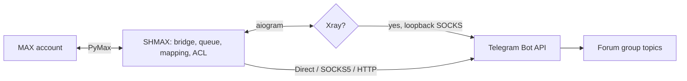
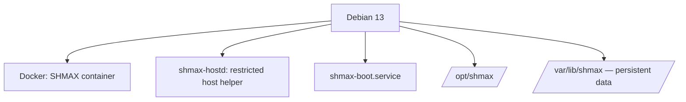

# SHMAX

**MAX ↔ Telegram Gateway**

<p align="center">
  
</p>

A self-hosted gateway between MAX and Telegram: an ordinary MAX
account is bridged into your own private Telegram supergroup with
forum topics. Your messages, your server.

[Русский](README.md) (canonical) · [Docs](docs/en/README.md) ·
[AI assistant guide](docs/AI_ASSISTANT_GUIDE.en.md)

<p align="center">
  
</p>


**v0.1.0 is prepared locally and remains unpublished.** SHMAX is an independent
open-source project, not an official product of Telegram or MAX.

Owner-confirmed acceptance: Debian 13 amd64, installation, messages/media,
upgrade with retained configuration, reboot and Docker/systemd health.
ARMv7/ODROID-XU4 remains experimental with incomplete physical acceptance.

## Why SHMAX

MAX and Telegram are separate ecosystems; sometimes you need MAX
messages delivered into Telegram (and back) without a third-party
cloud. SHMAX runs on your server (Debian 13 amd64 passed owner live acceptance), connects your MAX account to your bot and your private
forum-group: one MAX chat per Telegram topic, replies in both
directions, attributed authors, media with captions.

**THE APPLICATION IS DISPOSABLE. USER DATA IS PERSISTENT.**
Replace, roll back or recreate the container — `/var/lib/shmax`
stays yours.

## Features

- MAX (ordinary account, OTP + 2FA) ↔ Telegram bot ↔ forum topics
- One MAX chat ↔ one Telegram topic; replies both ways
- Media and captions; a polite fallback for unsupported attachments
- Author attributed exactly once (`[Name]:`); zero service markers
  in visible messages
- Telegram transport: Direct / SOCKS5 / HTTP proxy / Xray
  subscription (VLESS/Trojan, Reality; Vision on TCP; the local
  Xray is managed by SHMAX with a loopback-only SOCKS)
- Optional [member synchronization](docs/en/telegram-group.md): imports silent
  members with the existing bot using API ID/API Hash from my.telegram.org,
  without a userbot. API Hash is secret. Discovery grants no access: new users
  are unapproved; Telegram admin grants no SHMAX admin.
- Telegram users: approval, roles, blocking (fail-closed)
- Diagnostics and watchdogs; logs viewer
- Backups: DB + encrypted secret store + state; 0600 files; normal archives include
  the master key, whole-archive passphrase encryption is available via CLI/API
- Updates from GitHub Releases: stable/beta, SemVer, SHA256
  verified, manual install via shmax-hostd, automatic rollback
- Boot orchestration: returns after reboot without SSH (waits for
  the bind address, repairs broken port publication)
- Installer: install / repair / upgrade / uninstall (data kept)

## How it looks

| | |
|---|---|

Screenshots are **DEMO**: real production UI/backend with local external
MAX/Telegram mocks. Visible names/IDs are fixtures, not live service connections.

|  |  |
|  |  |

Full gallery: [docs/assets/screenshots/](docs/assets/screenshots/README.md).

## Architecture





More: [docs/en/architecture.md](docs/en/architecture.md) (full
component table in [docs/ru/architecture.md](docs/ru/architecture.md)).

## Quick start

From the root of the complete extracted SHMAX archive:

```bash
sudo bash deploy/installer/install.sh --mode install
```

The installer builds and starts the container and prints the
one-time setup URL (first install only). Then follow the 9-step
wizard: [docs/en/first-setup.md](docs/en/first-setup.md).

## Setup wizard

1 Admin · 2 MAX · 3 Telegram network · 4 Telegram bot ·
5 Telegram group · 6 MAX chats · 7 Users · 8 Test · 9 Finish —
with built-in "How?" help cards on every step.


After mandatory administrator creation, restore a backup or skip setup. Skipping opens the dashboard without completing configuration. Configure MAX and Telegram individually from their sections or continue the wizard from the dashboard. Click SHMAX to return home; unsaved changes require confirmation.

## Updates

Checked automatically every 24h and on demand; installed manually
only, via shmax-hostd, with a safety backup, SHA256 verification
and automatic rollback. Source: `SHMAX_UPDATE_REPO_URL` (GitHub
Releases, stable/beta). No Internet is needed at boot; GitHub is
used for update checks and downloads. The UI and boot orchestration start
without Internet; delivery requires MAX and Telegram connectivity. MAX stays direct.

## Backups

Local copies stay on the device. Portable export downloads one password-encrypted
.shmax file. After creating a fresh owner, choose restore and skip the remaining
setup steps. Destination owner credentials survive; old web sessions are revoked.
Contents and restore:
[docs/en/backups.md](docs/en/backups.md) /
[docs/en/restore.md](docs/en/restore.md).

## Security

No Docker socket in the web container; secrets in AES-256-GCM
SecretStore; Argon2id; CSRF; fail-closed ACL; verified update
artifacts. [docs/en/security.md](docs/en/security.md) ·
[SECURITY.md](SECURITY.md).

## ODROID-XU4 / ARMv7

Experimental designed target; physical acceptance is incomplete: [docs/en/odroid-xu4-armv7.md](docs/en/odroid-xu4-armv7.md).

## Troubleshooting

By symptom: [docs/en/troubleshooting.md](docs/en/troubleshooting.md).
Unreachable after reboot: [docs/en/reboot-startup.md](docs/en/reboot-startup.md).

## Documentation

Full tree: [docs/en/README.md](docs/en/README.md) ·
[docs/ru/README.md](docs/ru/README.md) (Russian, canonical) ·
[llms.txt](llms.txt).

## AI assistance

[docs/AI_ASSISTANT_GUIDE.en.md](docs/AI_ASSISTANT_GUIDE.en.md) —
so ChatGPT/Claude/Codex can help you set up and debug SHMAX
safely (no secrets, no "delete your data" advice).

## License

Code and original duck artwork — [AGPL-3.0-or-later](LICENSE).
The SHMAX name is branding: [TRADEMARKS.md](TRADEMARKS.md). Third-party
components — [THIRD_PARTY_NOTICES.md](THIRD_PARTY_NOTICES.md).

Photos and stickers in both directions: [support and limits](docs/en/media.md).
