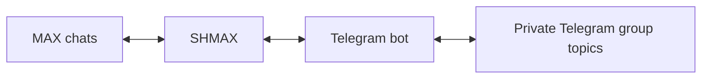

# SHMAX

**A self-hosted gateway between MAX and Telegram**

SHMAX connects conversations in MAX and Telegram. Messages from selected MAX
chats appear in topics within a private Telegram group; replies from Telegram
return to the corresponding MAX chats. The gateway runs on your server and
provides a web interface for connections, routing and user access.

[Русский](README.md) · [Documentation](docs/en/README.md) ·
[Releases](https://github.com/SHMAX-Project/SHMAX/releases) · [Security](SECURITY.md)


## Features

- **Bidirectional messaging.** Text, photos, documents and supported video,
  with reply mapping and sender attribution.
- **Topic routing.** Each connected MAX chat maps to a separate Telegram forum topic.
- **Access management.** User approval, roles, blocking and operator signatures.
  SHMAX permissions are managed separately from Telegram administrator permissions.
- **Network configuration.** Direct connections, SOCKS5, HTTP proxies and managed
  Xray transport for Telegram access.
- **Connection monitoring.** Integration status, diagnostics, logs and automatic
  recovery of saved Telegram transport.
- **Backups and migration.** Local backups and encrypted exports for moving
  configuration and data to another server.
- **Updates with rollback.** Checksum verification, backups before installation,
  application health checks and automatic rollback on failure.
- **Web interface.** Initial setup wizard, separate MAX and Telegram settings,
  unsaved-change protection and mobile layouts.

See [media documentation](docs/en/media.md) for attachment and sticker handling.

## How it works



SHMAX requires an ordinary MAX account, your own Telegram bot and a private
Telegram supergroup with topics enabled. Connections and chat mappings are
configured through the web interface. Each SHMAX instance connects to one
paired Telegram group.

Optional [member synchronization](docs/en/telegram-group.md) uses the existing
bot and Telegram API ID/API Hash. Discovering a participant does not grant
messaging access; approval is required.

## Requirements

- Debian 13 on amd64.
- Docker Engine, Docker Compose v2 and systemd.
- Administrator access to the server for installation.
- Server access to MAX, Telegram and dependency sources during installation.

The application runs in a container. Configuration, the database and credentials
are stored separately in `/var/lib/shmax` and persist across container replacement
and updates. See [architecture](docs/en/architecture.md) for component details.

## Installation

Download the complete production archive and `SHA256SUMS` from
[GitHub Releases](https://github.com/SHMAX-Project/SHMAX/releases).
Verify its checksum and extract the archive. From the extracted release directory, run:

```bash
sudo bash deploy/installer/install.sh --mode install
```

The installer prepares services, builds and starts the container, and provides
the initial setup link. Use the wizard to create an administrator, connect MAX
and Telegram, select chats and configure participant access.

[Installation guide](docs/en/installation.md) ·
[Initial setup](docs/en/first-setup.md) · [Troubleshooting](docs/en/troubleshooting.md)

## Updates and data

Administrators control when updates are installed. SHMAX creates a backup,
verifies the archive and checks application health after installation. If the
update fails, it rolls back.

Use a password-encrypted `.shmax` export to migrate to another server. Ordinary
local backups contain authorization material and require secure storage.
Stop the source gateway before starting the migrated instance.
[Backups](docs/en/backups.md) · [Restore](docs/en/restore.md).

## Interface

Screenshots show the interface with demonstration data.

| Telegram settings | Users |
|---|---|
|  |  |

| Chat routing | Mobile interface |
|---|---|
|  |  |

## Security

SHMAX encrypts its secret store, controls user access and protects web sessions.
The web container does not receive the Docker socket. Protect access to the
administration interface and store backups securely.

Report vulnerabilities through the private GitHub channel described in the
[security policy](SECURITY.md). Do not post credentials in issues.

## Documentation and contributions

[English documentation](docs/en/README.md) ·
[Документация на русском](docs/ru/README.md) ·
[AI assistant guide](docs/AI_ASSISTANT_GUIDE.en.md) · [Contributing](CONTRIBUTING.md)

SHMAX is an independent open-source project and is not affiliated with the
companies operating MAX or Telegram.

## License

SHMAX is licensed under [AGPL-3.0-or-later](LICENSE).
[Third-party components and licenses](THIRD_PARTY_NOTICES.md) ·
[Name and branding](TRADEMARKS.md).
