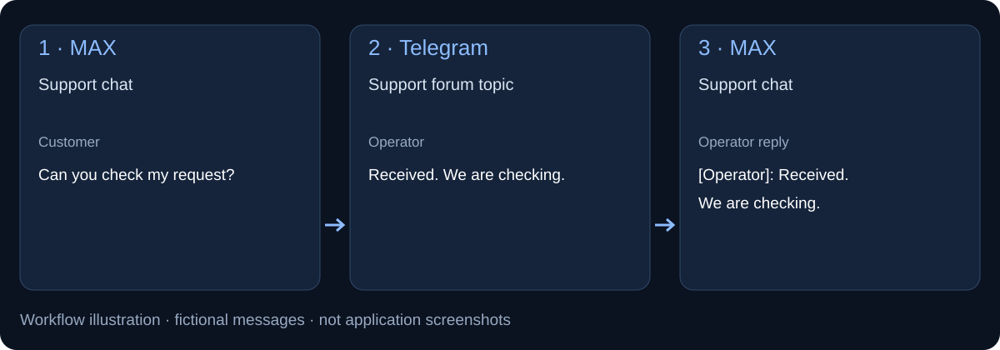
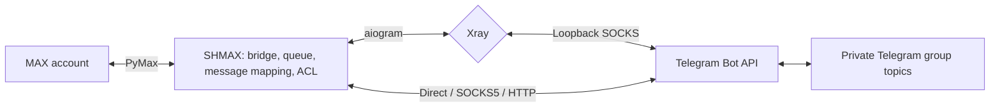
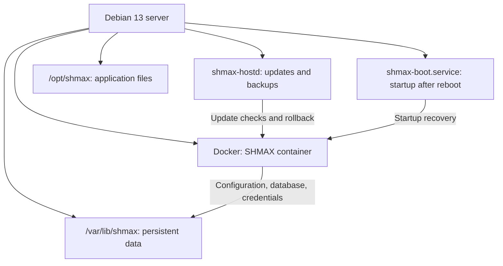
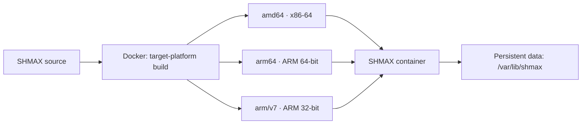

# SHMAX

**MAX ↔ Telegram on your server.** Reply to MAX conversations from Telegram topics and manage connections and access through a web dashboard.

```bash
curl -fsSL https://raw.githubusercontent.com/SHMAX-Project/SHMAX/main/install.sh | sudo bash
```

Debian 13 amd64 · [One-line installation](docs/en/installation.md#one-line-installation) · [Manual archive installation](docs/en/installation.md#manual-archive-installation).
**Latest stable release: [SHMAX v0.2.0](https://github.com/SHMAX-Project/SHMAX/releases/latest).**
The installer selects the latest stable release and verifies its signature and integrity.
[v0.2.0 release notes](release/v0.2.0/RELEASE_NOTES.en.md) · [Changelog](CHANGELOG.md).


[](backend/shmax/VERSION)
[](https://github.com/SHMAX-Project/SHMAX/actions/workflows/ci.yml)
[](LICENSE)
[](docs/en/architecture.md)

[](docs/en/installation.md)
[](Dockerfile)
[](Dockerfile)
[](docs/en/architecture.md)

SHMAX connects conversations in MAX and Telegram. Messages from selected MAX
chats appear in topics within a private Telegram group; replies from Telegram
return to the corresponding MAX chats. The gateway runs on your server and
provides a web interface for connections, routing and user access.

[Русский](README.md) · [Documentation](docs/en/README.md) ·
[Installation](docs/en/installation.md) · [Releases](https://github.com/SHMAX-Project/SHMAX/releases) ·
[Report an issue](https://github.com/SHMAX-Project/SHMAX/issues) · [Security](SECURITY.md)


## Follow a message through the bridge



The diagram uses fictional messages to illustrate routing. Actual SHMAX screenshots appear below.

## New in v0.2.0

Separate team groups, administrator overview and independent MAX/Telegram connections. [Changes and validation](release/v0.2.0/RELEASE_NOTES.en.md).

- [Multiple groups and administrator overview](docs/en/multi-group.md), explicit group grants, automatic topics and both directions of conversation.
- [Independent MAX direct/proxy/Xray networking](docs/en/max-network.md).
- [Resource graphs and group status](docs/en/dashboard.md).
- [Ten-step setup](docs/en/first-setup.md), preserved in-place configuration and import of old v1 backups alongside portable v2.


## New in v0.1.3

- Fixed captionless MAX albums failing before enqueue when the sender display name is unavailable. All photos enter the durable queue and retain the Telegram topic.
- Incoming-message processing failures now appear as ERROR events with direction and correlation ID. Message bodies and exception text are excluded from the journal.
- Messages that failed before enqueue in older versions are not recovered automatically. A journal error does not create a separate Telegram notification.

[v0.1.3 changes and validation](release/v0.1.3/RELEASE_NOTES.en.md).

## Changes in v0.1.2

- MAX reconnects after temporary disconnects using its saved session, without automatic SMS or logout.
- Xray switching no longer fails with TransportConfig; failed switches attempt to restore the previous node, and Telegram recovers its connection.
- A persistent [event journal](docs/en/event-journal.md) shows incoming messages, delivery attempts/results, connection failures and administrator actions. Search, filters and refresh are included; message text and credentials are excluded.
- Temporary MAX verification failures are distinct from revoked authentication. Empty requests and permanent Telegram errors no longer retry indefinitely.


[Full changes and limitations](release/v0.1.2/RELEASE_NOTES.en.md).

## Use cases

- **One team workspace.** Reply to MAX conversations from Telegram topics while keeping chats separate.
- **Multiple operators.** Approve participants, assign roles and control who can send messages.
- **Your own infrastructure.** Manage the SHMAX server, connections, stored data and backups yourself.

## Supported workflows

| Task | v0.2.0 capabilities |
|---|---|
| MAX ↔ Telegram | Bidirectional messages and reply mapping |
| Multiple MAX chats | Topics across multiple groups; each chat may have several destinations |
| Administrator overview | Automatic topics for new MAX chats and both sides of conversations |
| MAX and Telegram networking | Independent direct, HTTP, SOCKS5 or Xray selection |
| Attachments | MAX → Telegram albums of 2–10 photos, documents and supported video; [details and limits](docs/en/media.md) |
| Team access | Per-group send grants, global blocking and sender attribution |
| Server operations | Resource graphs, groups, event journal, historical backup import and updates with rollback |
| One-line installation | Verified on clean Debian 13 amd64; manual installation also supported |
| Other architectures | Docker build targets: arm64 and arm/v7; [platform details](docs/en/architecture.md) |

### Example workflow

1. Connect your MAX account and your own Telegram bot in the setup wizard.
2. Map a selected MAX chat to a topic in a private Telegram group.
3. Receive messages in that topic and reply from Telegram — SHMAX sends replies back to the MAX chat.

## Stable release validation

**v0.2.0:** 58 frontend tests, desktop/mobile setup and layout checks, 74 album/media/fanout regressions, and 8 historical backup formats passed. Debian acceptance: 164 passed, 1 environment skip; signed upgrade, component restart and full VM reboot verified. [Evidence and limits](release/v0.2.0/VALIDATION.md).

**v0.1.2:** 1002 backend tests passed, 9 skipped locally; 51 frontend tests and 26 desktop/mobile Playwright scenarios passed. Debian 13 amd64: 38 recovery/journal/queue regressions and 5 real-Xray checks; signed clean install, v0.1.1 → v0.1.2 upgrade, cold rollback and journal persistence after restart passed. [Details](release/v0.1.2/RELEASE_NOTES.en.md).

**v0.1.1:** 985 backend tests passed, 4 skipped; 46 frontend tests passed; typecheck — PASS. Validation covers 24 album regression scenarios, the 0.1.0 → 0.1.1 upgrade and rollback in an isolated Debian 13 amd64 VM. Public v0.1.1 download, signature and integrity were verified.

**v0.1.0 baseline checks:**

- **Clean installation:** Debian 13 amd64, automatic Docker/Compose setup, systemd and readiness checks.
- **Data preservation:** installer reruns and updates preserve synthetic settings, secrets, session files and SQLite.
- **Rollback:** a forced candidate rejection restores the previous image and cold data backup.
- **Package authenticity:** public stable download and the pinned signature were verified after publication.

[Debian VM acceptance](https://github.com/SHMAX-Project/SHMAX/actions/runs/38054225801) ·
[Release CI: 957 backend / 46 frontend tests](https://github.com/SHMAX-Project/SHMAX/actions/runs/38054452388).
VM data-preservation checks used synthetic settings and session files.
[First deployment experience](docs/en/deployment-story.md).

## Before installing

**What do I need?** A regular MAX account, your own Telegram bot and a private supergroup with topics enabled. The bot needs message sending and topic management permissions; disable Privacy Mode.

**Do I need a separate MAX account?** v0.2.0 connects one regular MAX account. Administrators may choose a dedicated work account.

**Where is my data?** On your server in `/var/lib/shmax`. Updates preserve it; keep backups to protect against disk failure.

**What happens after reboot?** Services restart the application. Delivery requires MAX and Telegram connectivity; the local dashboard can start without internet.

**Which attachments work?** Photos, documents and supported video. Animated stickers may become static images or text fallbacks. [Media limits](docs/en/media.md).

**Does MAX support proxies?** v0.2.0 supports independent direct, HTTP, SOCKS5 and Xray connections for MAX. Multiple MAX accounts remain on the [roadmap](docs/en/roadmap.md).

[Full FAQ](docs/en/faq.md) · [Contribute](CONTRIBUTING.md).

## Features

- **Bidirectional messaging.** Text, photos, documents and supported video,
  with reply mapping and sender attribution.
- **Topic routing.** Each connected MAX chat maps to a separate Telegram forum topic.
- **Access management.** User approval, roles, blocking and operator signatures.
  SHMAX permissions are managed separately from Telegram administrator permissions.
- **Network configuration.** Direct connections, SOCKS5, HTTP proxies and managed
  Xray transport for Telegram access.
- **Connection monitoring.** Integration status, diagnostics, logs and automatic
  recovery of saved Telegram transport.
- **Backups and migration.** Local backups and encrypted exports for moving
  configuration and data to another server.
- **Updates with rollback.** Checksum verification, backups before installation,
  application health checks and automatic rollback on failure.
- **Web interface.** Initial setup wizard, separate MAX and Telegram settings,
  unsaved-change protection and mobile layouts.

See [media documentation](docs/en/media.md) for attachment and sticker handling.

## How it works



## Deployment architecture



### Build architectures

The same SHMAX source is used to build containers for `amd64`, `arm64` and `arm/v7`.
The Dockerfile selects the platform-specific Xray binary and image dependencies;
application data is stored outside the container.




SHMAX requires an ordinary MAX account, your own Telegram bot and a private
Telegram supergroup with topics enabled. Connections and chat mappings are
configured through the web interface. Each SHMAX instance connects to one
paired Telegram group.

Optional [member synchronization](docs/en/telegram-group.md) uses the existing
bot and Telegram API ID/API Hash. Discovering a participant does not grant
messaging access; approval is required.

## Requirements

- Debian 13 on amd64.
- Docker Engine, Docker Compose v2 and systemd.
- Administrator access to the server for installation.
- Server access to MAX, Telegram and dependency sources during installation.

The application runs in a container. Configuration, the database and credentials
are stored separately in `/var/lib/shmax` and persist across container replacement
and updates. See [architecture](docs/en/architecture.md) for component details.

## Installation

The command at the top runs the bootstrap, verifies a signed stable package and
installs the application. Open the printed setup link to configure your integrations.

[Manual archive installation](docs/en/installation.md#manual-archive-installation)
remains supported: download → verify signature and checksum → extract → run
`sudo bash deploy/installer/install.sh --mode install`.

Update with `sudo shmax update`, or use a local verified archive:
`sudo shmax update /absolute/path/shmax-v0.2.0.tar.gz`.

[Installation and modes](docs/en/installation.md) · [First setup](docs/en/first-setup.md) ·
[Troubleshooting](docs/en/troubleshooting.md).

## Updates and data

Administrators control when updates are installed. SHMAX creates a backup,
verifies the archive and checks application health after installation. If the
update fails, it rolls back.

Use a password-encrypted `.shmax` export to migrate to another server. Ordinary
local backups contain authorization material and require secure storage.
Stop the source gateway before starting the migrated instance.
[Backups](docs/en/backups.md) · [Restore](docs/en/restore.md).

## Interface

Screenshots show the interface with demonstration data.

| Telegram settings | Users |
|---|---|
|  |  |

| Chat routing | Mobile interface |
|---|---|
|  |  |

## Security

SHMAX encrypts its secret store, controls user access and protects web sessions.
The web container does not receive the Docker socket. Protect access to the
administration interface and store backups securely.

Report vulnerabilities through the private GitHub channel described in the
[security policy](SECURITY.md). Do not post credentials in issues.

## Documentation and contributions

[English documentation](docs/en/README.md) ·
[Документация на русском](docs/ru/README.md) ·
[AI assistant guide](docs/AI_ASSISTANT_GUIDE.en.md) · [Contributing](CONTRIBUTING.md)

SHMAX is an independent open-source project and is not affiliated with the
companies operating MAX or Telegram.

## License

SHMAX is licensed under [AGPL-3.0-or-later](LICENSE).
[Third-party components and licenses](THIRD_PARTY_NOTICES.md) ·
[Name and branding](TRADEMARKS.md).
