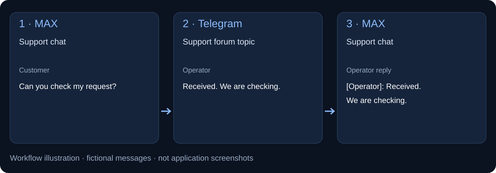
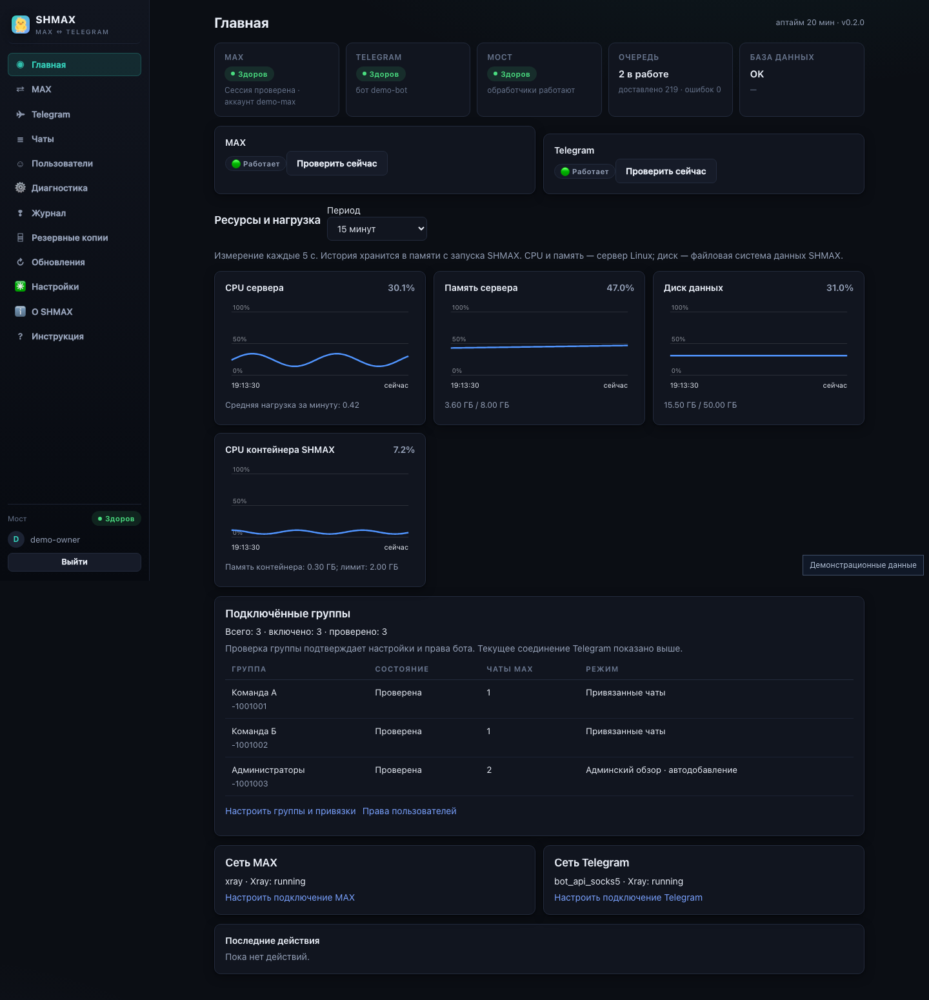
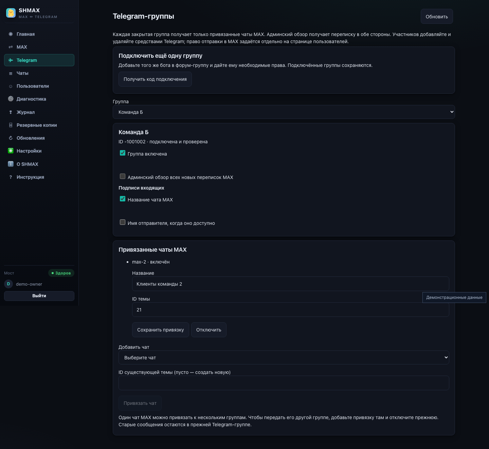
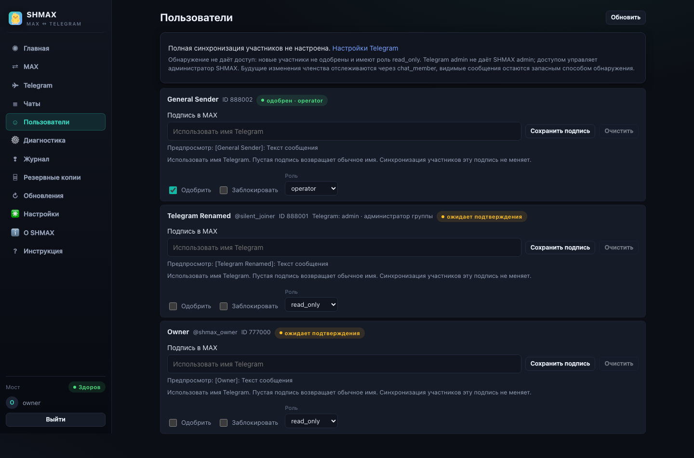
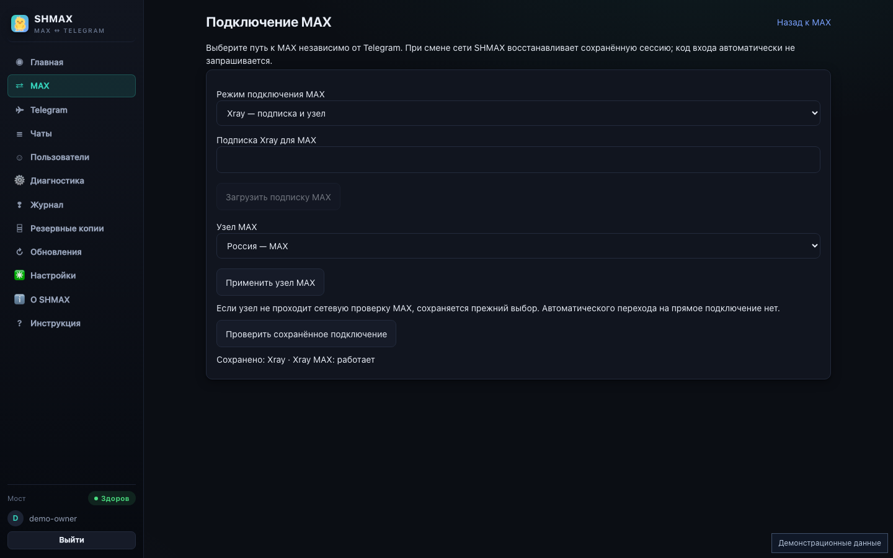
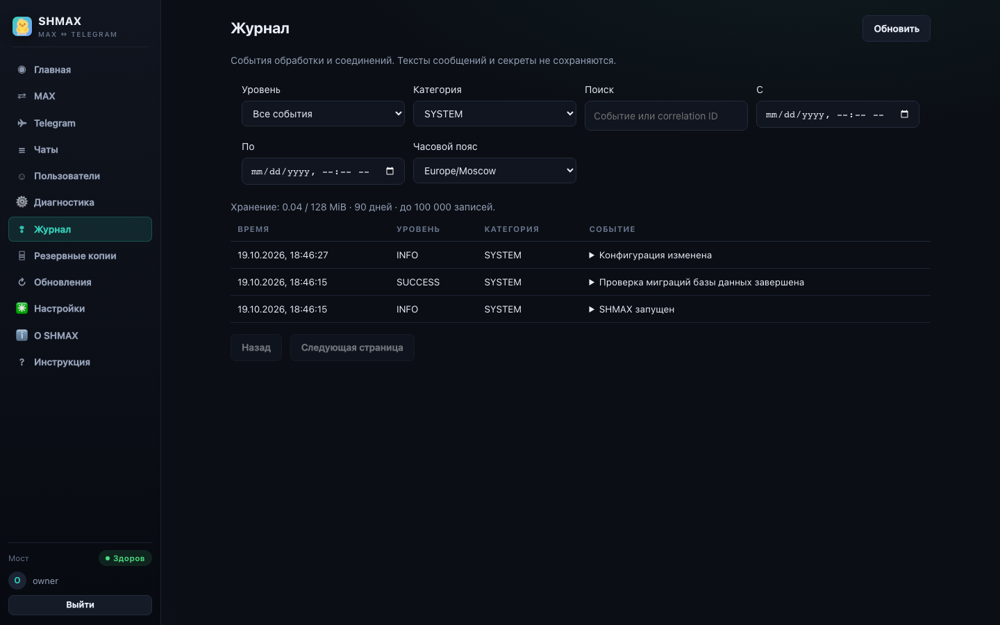
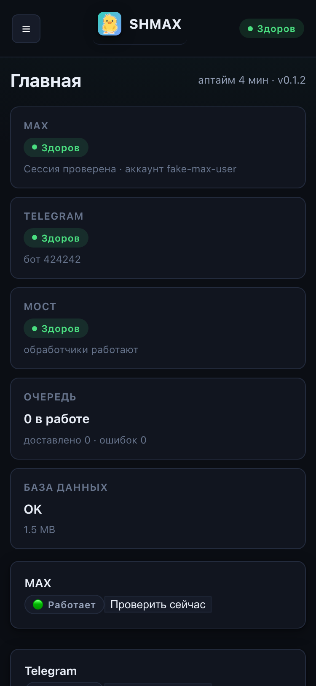
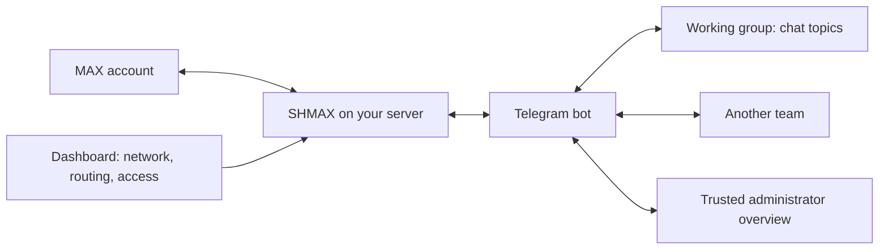

<p align="center"></p>

<h1 align="center">SHMAX</h1>
<p align="center"><strong>MAX on your server. Telegram on your phone.</strong></p>
<p align="center">Prefer not to install MAX on your personal phone?<br>SHMAX connects your account on a server or VPS.<br>Receive messages and reply from Telegram topics.</p>
<p align="center"><a href="#quick-start">Install</a> · <a href="docs/en/use-cases.md">Choose a workflow</a> · <a href="#interface">See the interface</a> · <a href="README.md">Русский</a></p>

<p align="center">
<a href="https://github.com/SHMAX-Project/SHMAX/releases/latest"></a>
<a href="https://github.com/SHMAX-Project/SHMAX/actions/workflows/ci.yml"></a>
<a href="docs/en/installation.md"></a>
<a href="LICENSE"></a>
</p>



*The diagram uses fictional messages. Screenshots below show the actual interface with demonstration data.*

## Keep MAX off participants’ phones

**For personal use:** bring selected MAX chats into your private Telegram group. Read and reply from Telegram — everyday messaging does not require the MAX app on your main phone.

**For a company:** connect a work MAX account on a server or VPS and route chats to your teams. Staff do not need to install MAX on personal phones or share the account session: they work through Telegram with SHMAX send permissions.

**Initial sign-in is a separate step.** The owner needs a MAX account, access to its phone number and the provider’s authentication checks. MAX may require setting up 2FA in an official app on an already authorized device. SHMAX does not bypass these requirements. [How this works and where the data goes →](docs/en/max-without-phone.md)

## Where SHMAX fits

**People message you in MAX; you prefer Telegram.** Connect the chats you need, give each its own topic and reply from the app you already use. Your contacts keep using MAX.

**You have several teams.** Route chats into separate private Telegram groups: support gets its conversations, another team gets theirs. Permissions to send to MAX are assigned per group.

**You need an overview.** Use a trusted administrator group: SHMAX can automatically create topics for new MAX chats and show incoming messages and confirmed replies.

**It runs on your server.** You control SHMAX connections, access, stored data and backups. Use the web dashboard for configuration; keep everyday conversations in Telegram.

[Explore workflows step by step →](docs/en/use-cases.md)

## Interface

The dashboard shows MAX and Telegram connectivity, groups, the queue and server resources.



<details>
<summary><strong>Explore chat routing, permissions and the mobile interface</strong></summary>

### Which chat goes where



### Who can reply



### Networking and event history

| Independent MAX connection | Investigate delivery issues |
|---|---|
|  |  |

<p align="center"></p>

Screenshots use demonstration connections, not customer conversations. [Screenshot provenance](docs/assets/screenshots/README.md).

</details>

## Quick start

You need a **Debian 13 amd64 server**, root/sudo access, one regular MAX account and your own Telegram bot. Create a private Telegram group with **topics** enabled. Give the bot message-sending and topic-management permissions and disable Privacy Mode.

```bash
curl -fsSL https://raw.githubusercontent.com/SHMAX-Project/SHMAX/main/install.sh | sudo bash
```

The installer downloads the latest stable release, verifies the package signature and integrity, prepares Docker/Compose and prints the setup link.

1. **Open the link and create the SHMAX owner.** This is a local dashboard account.
2. **Connect MAX and Telegram in the wizard.** Their network settings are independent. The wizard guides you through MAX sign-in, the bot and group pairing.
3. **Select MAX chats and approve senders.** Each chat gets a topic. Send a message from MAX and reply from Telegram to check both directions.

[Installation guide](docs/en/installation.md) · [Step-by-step wizard](docs/en/first-setup.md) · [Manual installation with signature verification](docs/en/installation.md#manual-archive-installation) · [Troubleshooting](docs/en/troubleshooting.md)

## What the current version does

| You want to… | SHMAX provides… |
|---|---|
| Reply to MAX from Telegram | Bidirectional messages, reply mapping and sender labels |
| Keep conversations separate | MAX chats mapped to individual topics; a chat can reach multiple groups |
| Work as a team | Per-group send permissions, roles and global user blocking |
| Share attachments | MAX → Telegram photo albums of 2–10 images, documents and supported video; [limits](docs/en/media.md) |
| Configure different connections | Independent direct, HTTP, SOCKS5 and managed Xray networking for MAX and Telegram |
| Investigate an outage | Connection status, queue, event journal and resource graphs |
| Update or move servers | Signed updates, backups and encrypted migration; [update and rollback procedure](docs/en/updates.md) |

**Stable release: [v0.2.0](https://github.com/SHMAX-Project/SHMAX/releases/latest).** Multiple working groups, administrator overview, independent MAX networking and resource graphs are available now. [Release notes](release/v0.2.0/RELEASE_NOTES.en.md) · [Changelog](CHANGELOG.md).

## Know before you deploy

- **One MAX account per instance.** Multiple Telegram groups are supported; multiple MAX accounts are not yet supported.
- **Privacy spans the whole delivery chain.** SHMAX stores its data on your server, but messages also pass through MAX and Telegram. Group members can read history according to Telegram rules. Use separate private groups to separate visibility; SHMAX permissions control sending to MAX.
- **Keep administrator overview private.** It may include personal chats from the connected account. Existing MAX history is not automatically imported.
- **The server needs access to both services.** Check status and the journal during an outage. An uncertain external API response cannot guarantee exactly-once delivery.
- **Validated platform: Debian 13 amd64.** ARM64 and ARMv7 are experimental Docker build targets without completed physical acceptance. Resource history is kept in memory for up to one hour.

[FAQ](docs/en/faq.md) · [Security](SECURITY.md) · [Roadmap](docs/en/roadmap.md)

## Updates and persistent data

Configuration, the database and sessions live in `/var/lib/shmax`, outside the container. Run `sudo shmax update`: SHMAX verifies the package, creates a cold backup, checks the candidate and rolls back on failure. Keep a verified backup before upgrading; reverting an older schema requires a pre-upgrade backup.

Use a password-encrypted `.shmax` export to migrate. Stop the original instance before starting the new one: two gateways must not serve the same account and bot simultaneously.

[Backups](docs/en/backups.md) · [Migration and restore](docs/en/restore.md) · [First deployment experience](docs/en/deployment-story.md)

<details>
<summary><strong>Architecture and release validation</strong></summary>



v0.2.0 validation includes a signed Debian 13 amd64 upgrade, data migration, component restarts and a full VM reboot. Separate runs cover frontend, albums, group delivery and historical backup formats. No real test messages were sent during that acceptance; coverage of every external provider/media combination is not claimed.

[Validation report and limits](release/v0.2.0/VALIDATION.md) · [Architecture](docs/en/architecture.md) · [Groups and permissions](docs/en/multi-group.md)

</details>

## Documentation and help

[English docs](docs/en/README.md) · [Документация RU](docs/ru/README.md) · [Report a bug](https://github.com/SHMAX-Project/SHMAX/issues/new/choose) · [Contribute](CONTRIBUTING.md) · [Agent instructions](docs/AI_ASSISTANT_GUIDE.en.md)

If SHMAX is useful to you, star the project or share your workflow in [project issues](https://github.com/SHMAX-Project/SHMAX/issues). Keep credentials, sessions and customer conversations out of public reports.

SHMAX is an independent project, unaffiliated with the companies operating MAX or Telegram. [AGPL-3.0-or-later](LICENSE) · [Third-party licenses](THIRD_PARTY_NOTICES.md) · [Name and branding](TRADEMARKS.md).
