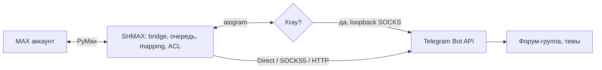
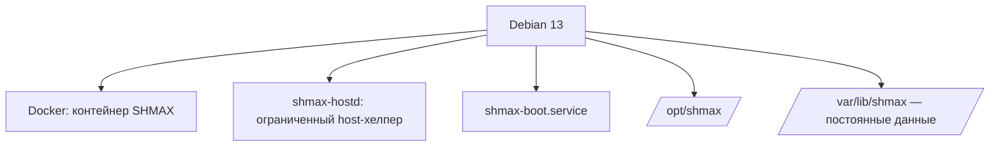

# SHMAX

**MAX ↔ Telegram Gateway**

<p align="center">
  
</p>

Самостоятельный шлюз между MAX и Telegram: обычный аккаунт MAX
подключается к приватной Telegram-супергруппе с форум-темами.
Ваши сообщения — на вашем сервере.

[English](README.en.md) · [Документация](docs/ru/README.md) ·
[AI-гайд для ассистентов](docs/AI_ASSISTANT_GUIDE.ru.md)

<p align="center">
  
</p>


**v0.1.0 подготовлен локально, ещё не опубликован.** SHMAX — независимый
open-source проект, не официальный продукт Telegram или MAX.

Подтверждено владельцем: Debian 13 amd64, установка, мост/медиа, обновление
с сохранением конфигурации, reboot, Docker/systemd health. ARMv7/ODROID-XU4
остаётся экспериментальной целью без завершённой физической приёмки.

## Зачем нужен SHMAX

MAX и Telegram — две разные экосистемы, и иногда нужно, чтобы
сообщения из MAX приходили в Telegram (или наоборот) без облаков
посередине. SHMAX ставится на ваш сервер (живую приёмку прошёл Debian 13 amd64), соединяет ваш аккаунт MAX с вашим ботом и вашей
приватной группой-форумом: один чат MAX — одна тема Telegram,
ответы ходят в обе стороны, автор подписан, медиа доставляется.

**Приложение одноразово. Данные постоянны.** Контейнер можно
заменять, откатывать, пересоздавать — `/var/lib/shmax` остаётся
вашим.

## Что умеет

- Мост MAX (обычный аккаунт, OTP + 2FA) ↔ Telegram-бот ↔ форум-темы
- Один чат MAX ↔ одна тема Telegram; ответы в обе стороны
- Медиа и подписи; вежливый фолбэ для неподдерживаемых вложений
- Автор подписан ровно один раз (`[Имя]:`); никаких служебных
  маркеров в видимых сообщениях
- Telegram-сеть: Direct / SOCKS5 / HTTP-прокси / Xray-подписка
  (VLESS/Trojan, Reality; Vision на TCP; локальный Xray управляется
  SHMAX, SOCKS только на 127.0.0.1)
- Необязательная [синхронизация участников](docs/ru/telegram-group.md): импорт
  молчавших участников существующим ботом с API ID/API Hash из my.telegram.org,
  без userbot. API Hash — секрет. Обнаружение не выдаёт доступ: новые участники
  не одобрены; Telegram admin не даёт SHMAX admin.
- Пользователи Telegram: одобрение, роли, блокировки (fail-closed)
- Диагностика и watchdog'и (MAX/Telegram), журнал
- Резервные копии: БД + шифрованное хранилище секретов + состояние;
  файлы 0600; обычный архив включает мастер-ключ, шифрование всего архива
  с фразой-паролем доступно через CLI/API
- Обновления из GitHub Releases: stable/beta, SemVer, проверка
  SHA256, установка вручную через shmax-hostd, авто-откат
- Boot-оркестрация: возврат после ребута без SSH (ожидание
  адреса, восстановление публикации порта)
- Инсталлятор: install / repair / upgrade / uninstall (данные
  сохраняются)

## Как это выглядит

| | |
|---|---|

Скриншоты — **DEMO**: настоящий production UI и backend; внешние MAX/Telegram
заменены локальными mocks. Видимые имена/ID — тестовые, не живые подключения.

|  |  |
|  |  |

Полный набор: [docs/assets/screenshots/](docs/assets/screenshots/README.md).

## Архитектура





Подробнее: [docs/ru/architecture.md](docs/ru/architecture.md).

## Быстрый старт

Из корня полного распакованного архива SHMAX:

```bash
sudo bash deploy/installer/install.sh --mode install
```

Инсталлятор соберёт и запустит контейнер и напечатает одноразовую
ссылку настройки (только для первой установки). Дальше — мастер из
9 шагов: [docs/ru/first-setup.md](docs/ru/first-setup.md).

## Мастер настройки

1 Администратор · 2 MAX · 3 Telegram сеть · 4 Telegram бот ·
5 Telegram группа · 6 MAX чаты · 7 Пользователи · 8 Проверка ·
9 Готово. Подсказки «Как это сделать?» встроены в каждый шаг.


После обязательного создания администратора можно восстановить копию или пропустить настройку. Пропуск открывает главную, но не завершает конфигурацию. MAX и Telegram настраиваются отдельно в своих разделах; на главной можно продолжить мастер. Нажатие SHMAX возвращает на главную с подтверждением несохранённых изменений.

## Обновления

Проверка — автоматически раз в 24 часа и по кнопке; установка —
только вручную, через shmax-hostd, с резервной копией, проверкой
SHA256 и автоматическим откатом. Источник: `SHMAX_UPDATE_REPO_URL`
(GitHub Releases, stable/beta). Без интернета при загрузке
сервера запускаются веб-интерфейс и boot-оркестрация. Доставка требует
доступа к MAX и Telegram; MAX подключается напрямую. GitHub нужен для проверки
и скачивания обновлений.

## Резервные копии

Локальная копия остаётся на устройстве. «Экспортировать для переноса» скачивает
один обязательно зашифрованный .shmax с паролем. На свежей установке после
создания владельца выберите восстановление и пропустите остальные шаги мастера.
Логин нового владельца сохраняется; старые веб-сеансы отзываются. Состав и восстановление:
[docs/ru/backups.md](docs/ru/backups.md) /
[docs/ru/restore.md](docs/ru/restore.md).

## Безопасность

Никакого Docker socket в веб-контейнере; секреты — AES-256-GCM
(SecretStore); Argon2id; CSRF; ACL fail-closed; проверка артефактов
обновлений. [docs/ru/security.md](docs/ru/security.md) ·
[SECURITY.md](SECURITY.md).

## ODROID-XU4 / ARMv7

Экспериментальная проектная цель; физическая приёмка не завершена: [docs/ru/odroid-xu4-armv7.md](docs/ru/odroid-xu4-armv7.md).

## Troubleshooting

По симптомам: [docs/ru/troubleshooting.md](docs/ru/troubleshooting.md).
Не открывается после ребута:
[docs/ru/reboot-startup.md](docs/ru/reboot-startup.md).

## Документация

Полное дерево: [docs/ru/README.md](docs/ru/README.md) (рус.,
каноническое) · [docs/en/README.md](docs/en/README.md) (English) ·
[llms.txt](llms.txt).

## Помощь с AI

[docs/AI_ASSISTANT_GUIDE.ru.md](docs/AI_ASSISTANT_GUIDE.ru.md) —
документ, по которому ChatGPT/Claude/Codex помогут настраивать и
чинить SHMAX безопасно (без секретов, без «удалите данные»).

## Лицензия

Код и оригинальная уточка — [AGPL-3.0-or-later](LICENSE). Имя SHMAX —
бренд: [TRADEMARKS.md](TRADEMARKS.md). Сторонние компоненты —
[THIRD_PARTY_NOTICES.md](THIRD_PARTY_NOTICES.md).

Фото и стикеры в обе стороны: [поддержка и ограничения](docs/ru/media.md).
