# SHMAX

**MAX ↔ Telegram на вашем сервере.** Отвечайте на сообщения MAX из тем Telegram; управляйте подключениями и доступом через веб-панель.

```bash
curl -fsSL https://raw.githubusercontent.com/SHMAX-Project/SHMAX/main/install.sh | sudo bash
```

Debian 13 amd64 · [Установка одной командой](docs/ru/installation.md#одной-командой) · [Ручная установка из архива](docs/ru/installation.md#ручная-установка-из-архива).
**Последний стабильный выпуск: [SHMAX v0.1.3](https://github.com/SHMAX-Project/SHMAX/releases/latest).**
Установщик выбирает последний стабильный выпуск и проверяет подпись и целостность пакета.
[Изменения v0.1.3](release/v0.1.3/RELEASE_NOTES.ru.md) · [Changelog](CHANGELOG.md).

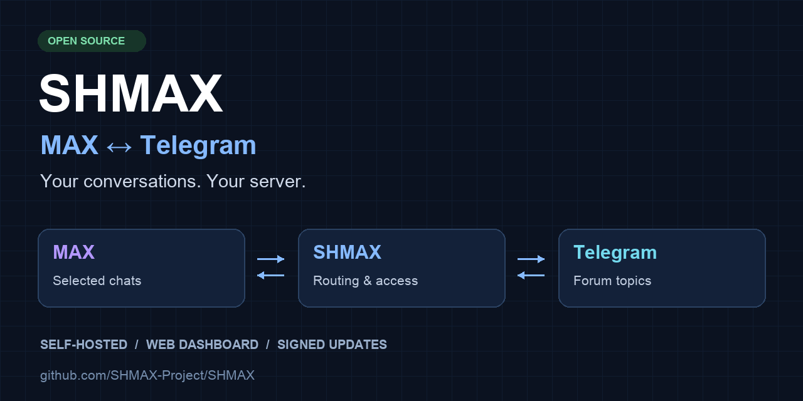

[](backend/shmax/VERSION)
[](https://github.com/SHMAX-Project/SHMAX/actions/workflows/ci.yml)
[](LICENSE)
[](docs/ru/architecture.md)

[](docs/ru/installation.md)
[](Dockerfile)
[](Dockerfile)
[](docs/ru/architecture.md)

SHMAX объединяет переписку в MAX и Telegram. Сообщения из выбранных чатов MAX
поступают в темы приватной Telegram-группы; ответы из Telegram отправляются
обратно в соответствующие чаты MAX. Шлюз работает на вашем сервере и предоставляет
веб-интерфейс для настройки подключений, маршрутов и доступа пользователей.

[English](README.en.md) · [Документация](docs/ru/README.md) ·
[Установка](docs/ru/installation.md) · [Выпуски](https://github.com/SHMAX-Project/SHMAX/releases) ·
[Сообщить о проблеме](https://github.com/SHMAX-Project/SHMAX/issues) · [Безопасность](SECURITY.md)

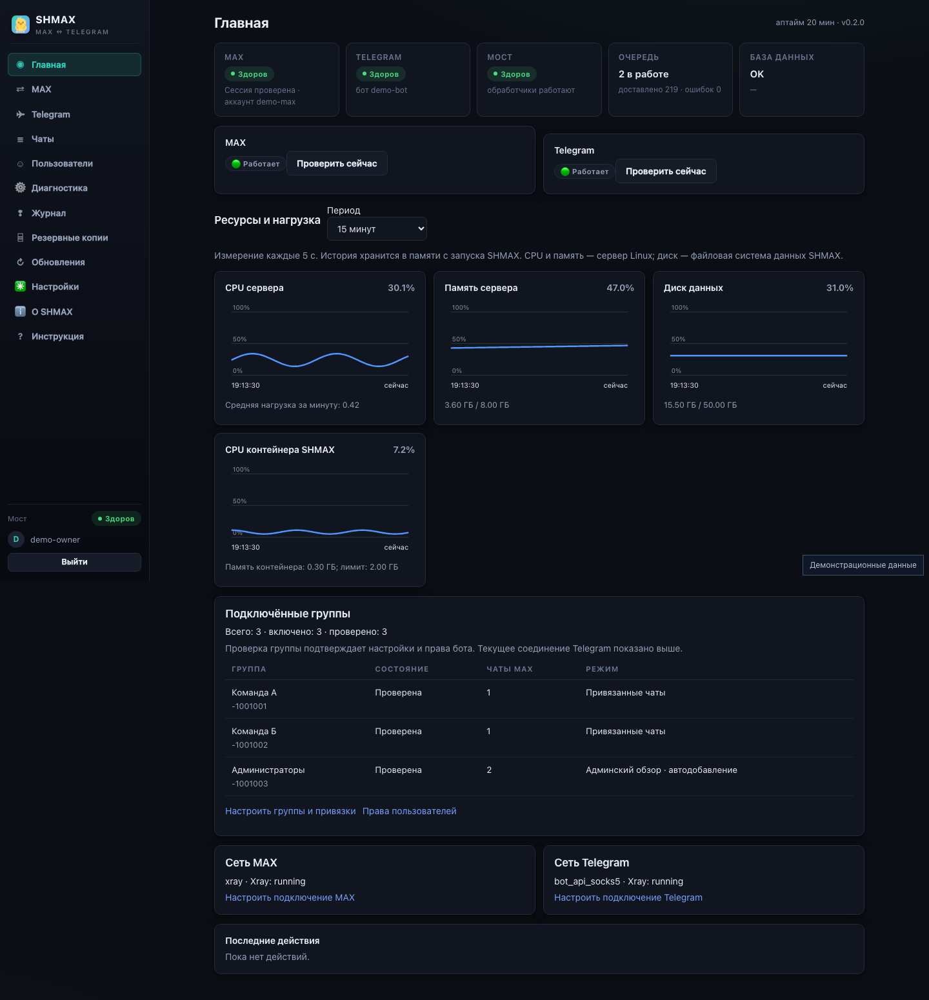

## Сообщение проходит весь путь

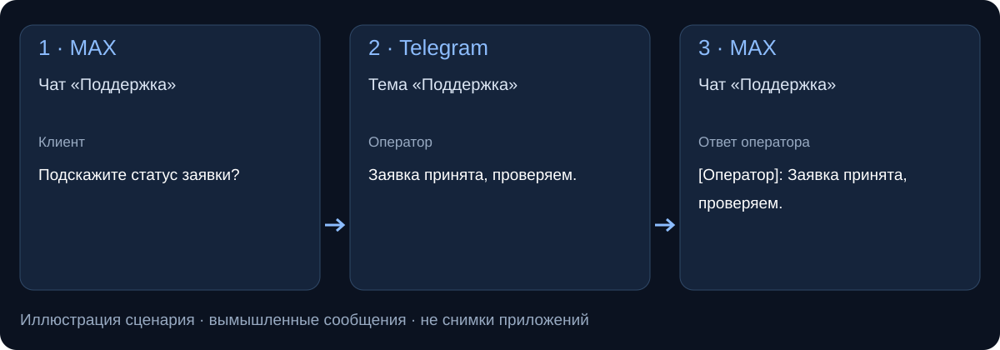

Пример показывает маршрут на вымышленных сообщениях. Реальный интерфейс SHMAX показан на скриншотах ниже.

## Что нового в v0.1.3

- Исправлена недоставка альбома без подписи, если MAX не передал имя отправителя. Все фотографии сохраняются в очереди и отправляются в выбранную тему Telegram.
- Ошибка обработки входящего сообщения теперь видна в журнале как ERROR с направлением и идентификатором корреляции. Тексты сообщений и исключений в журнал не попадают.
- Сообщения, упавшие до очереди в старых версиях, автоматически не восстанавливаются. Новая запись журнала не означает отдельное уведомление в Telegram.

[Изменения и проверки v0.1.3](release/v0.1.3/RELEASE_NOTES.ru.md).

## Изменения v0.1.2

- MAX восстанавливает временные разрывы через сохранённую сессию; повторный SMS и ручной вход при обычном сетевом сбое не нужны.
- Переключение Xray больше не прерывается ошибкой TransportConfig; при неудаче выполняется попытка вернуть прежний узел, Telegram восстанавливает соединение.
- Постоянный [журнал событий](docs/ru/event-journal.md) показывает входящие сообщения, попытки и результаты доставки, сетевые сбои и действия администратора. Есть поиск, фильтры и обновление; тексты сообщений и секреты не сохраняются.
- Временная невозможность проверить MAX отличается от отозванной авторизации. Пустые запросы и постоянные ошибки Telegram не повторяются бесконечно.

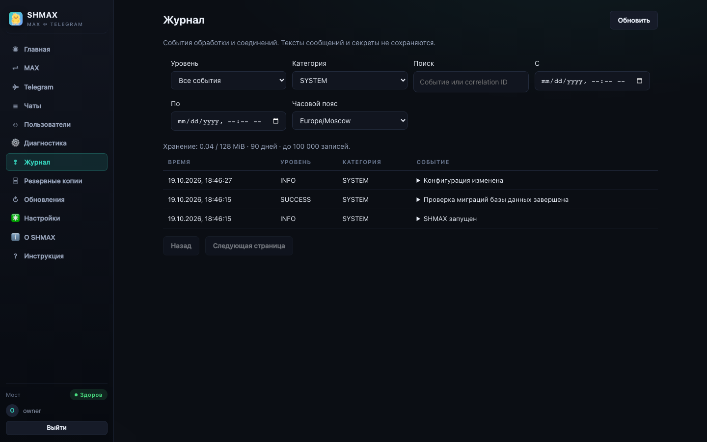

[Все изменения и ограничения](release/v0.1.2/RELEASE_NOTES.ru.md).

## Для каких задач

- **Единое рабочее пространство.** Команда отвечает на переписку MAX из тем Telegram, сохраняя разделение по чатам.
- **Доступ для нескольких операторов.** Администратор одобряет участников, назначает роли и контролирует право отправки сообщений.
- **Размещение на своей инфраструктуре.** Организация управляет сервером, подключениями, данными и резервными копиями SHMAX.

## Что поддерживается

| Задача | Возможности v0.1.3 |
|---|---|
| MAX ↔ Telegram | Двусторонняя передача сообщений и сопоставление ответов |
| Несколько чатов MAX | Отдельная тема приватной Telegram-группы для каждого подключённого чата |
| Вложения | Фотоальбомы MAX → Telegram по 2–10 фото, документы и поддерживаемое видео; [подробности и ограничения](docs/ru/media.md) |
| Работа команды | Одобрение участников, роли, блокировки и подписи операторов |
| Управление сервером | Веб-панель, постоянный журнал событий, диагностика, резервные копии и обновление с откатом |
| Установка одной командой | Проверена на чистом Debian 13 amd64; ручная установка также поддерживается |
| Другие архитектуры | Цели сборки Docker: arm64 и arm/v7; [сведения о платформах](docs/ru/architecture.md) |

### Пример рабочего процесса

1. Подключите аккаунт MAX и собственного Telegram-бота в мастере настройки.
2. Свяжите нужный чат MAX с темой приватной Telegram-группы.
3. Получайте сообщения в этой теме и отвечайте из Telegram — SHMAX отправляет ответы обратно в чат MAX.

## Проверки стабильных выпусков

**v0.1.2:** 1002 backend-теста пройдены, 9 пропущены в локальном запуске; 51 frontend-тест и 26 desktop/mobile Playwright-сценариев пройдены. На Debian 13 amd64: 38 recovery/journal/queue-регрессий и 5 проверок реального Xray; чистая подписанная установка, обновление v0.1.1 → v0.1.2, холодный откат и сохранение журнала после перезапуска — PASS. [Подробности](release/v0.1.2/RELEASE_NOTES.ru.md).

**v0.1.1:** 985 backend-тестов пройдено, 4 пропущено; 46 frontend-тестов пройдено; typecheck — PASS. Проверены 24 регрессионных сценария фотоальбомов, обновление 0.1.0 → 0.1.1 и откат в изолированной Debian 13 amd64 VM. Публичная загрузка, подпись и целостность v0.1.1 проверены.

**Базовые проверки v0.1.0:**

- **Чистая установка:** Debian 13 amd64, автоматическая установка Docker/Compose, systemd и проверка готовности.
- **Сохранение данных:** повторный запуск установщика и обновление сохраняют тестовые настройки, секреты, файлы сессий и SQLite.
- **Откат:** принудительный отказ кандидата восстанавливает предыдущий образ и холодную копию данных.
- **Подлинность пакета:** после публикации проверена загрузка стабильного релиза и подпись встроенным ключом.

[Проверка Debian VM](https://github.com/SHMAX-Project/SHMAX/actions/runs/38054225801) ·
[CI выпуска: 957 backend / 46 frontend тестов](https://github.com/SHMAX-Project/SHMAX/actions/runs/38054452388).
Проверки сохранения данных в VM использовали синтетические настройки и файлы сессий.
[Первый опыт эксплуатации](docs/ru/deployment-story.md).

## Перед установкой

**Что нужно подключить?** Обычный аккаунт MAX, собственный Telegram-бот и приватную супергруппу с темами. Боту нужны отправка сообщений и управление темами; Privacy Mode отключается.

**Нужен ли отдельный аккаунт MAX?** В v0.1.2 подключается один обычный аккаунт MAX. Отдельный рабочий аккаунт можно использовать по решению администратора.

**Где хранятся данные?** На вашем сервере в `/var/lib/shmax`. Обновление сохраняет их; для защиты от поломки диска нужны резервные копии.

**Что после перезагрузки?** Службы восстанавливают запуск приложения. Доставка требует доступности MAX и Telegram; без интернета возможен запуск локальной панели.

**Какие вложения доступны?** Фото, документы и поддерживаемое видео. Анимированные стикеры могут передаваться статическим представлением или текстовой заглушкой. [Ограничения медиа](docs/ru/media.md).

**Работает ли MAX через прокси?** В v0.1.2 MAX подключается напрямую. Прокси MAX, несколько аккаунтов и права на отдельные маршруты входят в [дорожную карту](docs/ru/roadmap.md).

[Полный FAQ](docs/ru/faq.md) · [Помочь проекту](CONTRIBUTING.md).

## Возможности

- **Обмен сообщениями в обе стороны.** Текст, фото, документы и поддерживаемое
  видео; сопоставление ответов и подписи отправителей.
- **Маршрутизация по темам.** Каждый подключённый чат MAX связан с отдельной
  темой Telegram-форума.
- **Управление доступом.** Одобрение участников, роли, блокировки и подписи
  операторов. Права в SHMAX настраиваются отдельно от прав администратора Telegram.
- **Настройка сети.** Прямое подключение, SOCKS5, HTTP-прокси и управляемый Xray
  для доступа к Telegram.
- **Контроль подключений.** Состояние интеграций, диагностика, журнал и
  автоматическое восстановление сохранённого Telegram-транспорта.
- **Резервное копирование.** Локальные копии и зашифрованный экспорт для переноса
  конфигурации и данных на другой сервер.
- **Обновление с откатом.** Проверка контрольных сумм, резервная копия перед
  установкой, проверка работоспособности и автоматический откат при ошибке.
- **Веб-интерфейс.** Мастер первоначальной настройки, отдельные настройки MAX
  и Telegram, защита несохранённых изменений и адаптация для мобильных устройств.

Подробности обработки вложений и стикеров приведены в [документации по медиа](docs/ru/media.md).

## Как работает шлюз

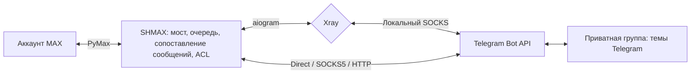

## Архитектура развёртывания

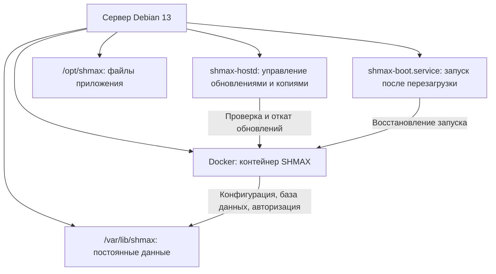

### Архитектуры сборки

Один исходный код используется для сборки контейнеров `amd64`, `arm64` и `arm/v7`.
Dockerfile выбирает платформенный бинарный файл Xray и зависимости образа;
данные приложения хранятся вне контейнера.

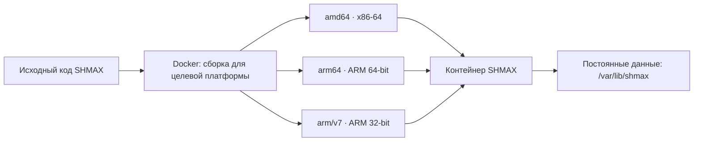


Для работы нужны обычный аккаунт MAX, собственный Telegram-бот и приватная
супергруппа Telegram с включёнными темами. Подключения и соответствия чатов
настраиваются в веб-интерфейсе. Один экземпляр SHMAX работает с одной
связанной Telegram-группой.

Необязательная [синхронизация участников](docs/ru/telegram-group.md) использует
существующего бота и Telegram API ID/API Hash. Обнаружение участника не выдаёт
ему право отправлять сообщения: доступ предоставляется после одобрения.

## Требования

- Debian 13, архитектура amd64.
- Docker Engine, Docker Compose v2 и systemd.
- Права администратора сервера для установки.
- Доступ сервера к MAX, Telegram и источникам зависимостей при установке.

Приложение работает в контейнере. Конфигурация, база данных и авторизация хранятся
отдельно в `/var/lib/shmax` и сохраняются при замене контейнера и обновлении.
Описание компонентов: [архитектура](docs/ru/architecture.md).

## Установка

Одна команда в начале страницы запускает bootstrap, который проверяет подписанный
стабильный пакет и выполняет установку. По завершении откройте напечатанную ссылку
и пройдите мастер настройки.

[Ручная установка из архива](docs/ru/installation.md#ручная-установка-из-архива) также
поддерживается: скачать → проверить подпись и сумму → распаковать → запустить
`sudo bash deploy/installer/install.sh --mode install`.

Обычное обновление: `sudo shmax update`. Сохраняется и обновление из локального
архива: `sudo shmax update /полный/путь/shmax-v0.1.3.tar.gz`.

[Установка и режимы](docs/ru/installation.md) · [Первоначальная настройка](docs/ru/first-setup.md) ·
[Решение проблем](docs/ru/troubleshooting.md).

## Обновления и данные

Обновления устанавливаются по решению администратора. Перед установкой SHMAX
создаёт резервную копию, проверяет архив и после обновления контролирует
работоспособность приложения. При ошибке выполняется откат.

Для переноса на другой сервер используйте зашифрованный экспорт `.shmax` с
паролем. Обычная локальная копия содержит материал авторизации и требует
защищённого хранения. Перед запуском перенесённого экземпляра остановите исходный
шлюз. [Резервные копии](docs/ru/backups.md) · [Восстановление](docs/ru/restore.md).

## Интерфейс

Скриншоты показывают интерфейс с демонстрационными данными.

| Настройки Telegram | Пользователи |
|---|---|
| 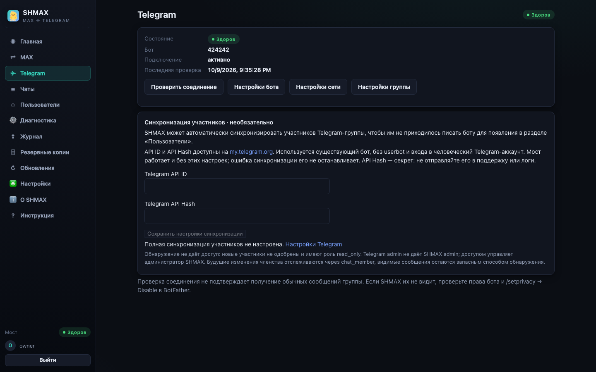 | 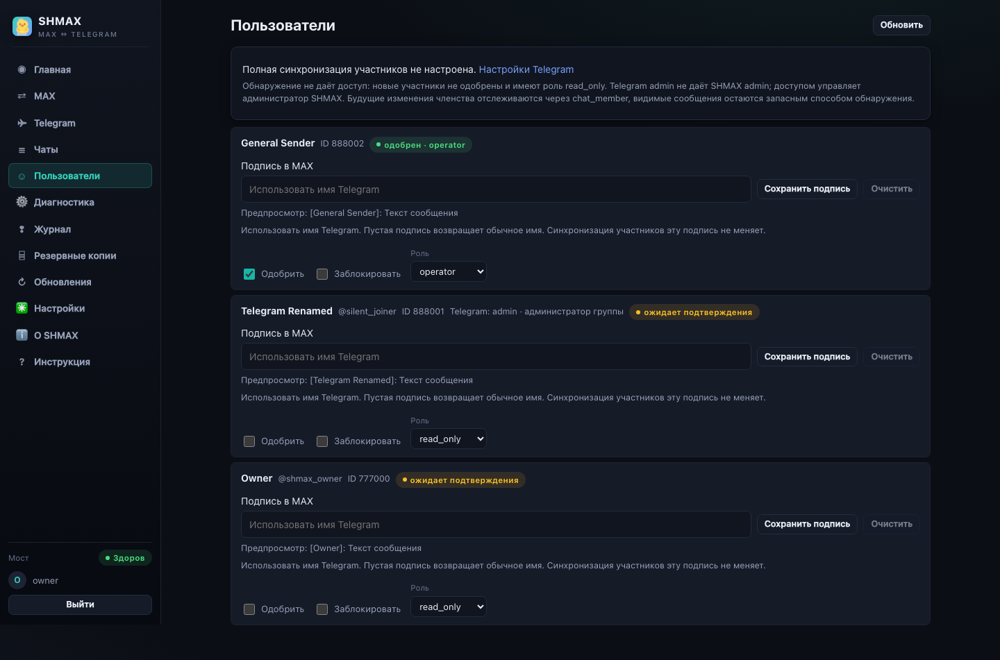 |

| Маршрутизация чатов | Мобильный интерфейс |
|---|---|
| 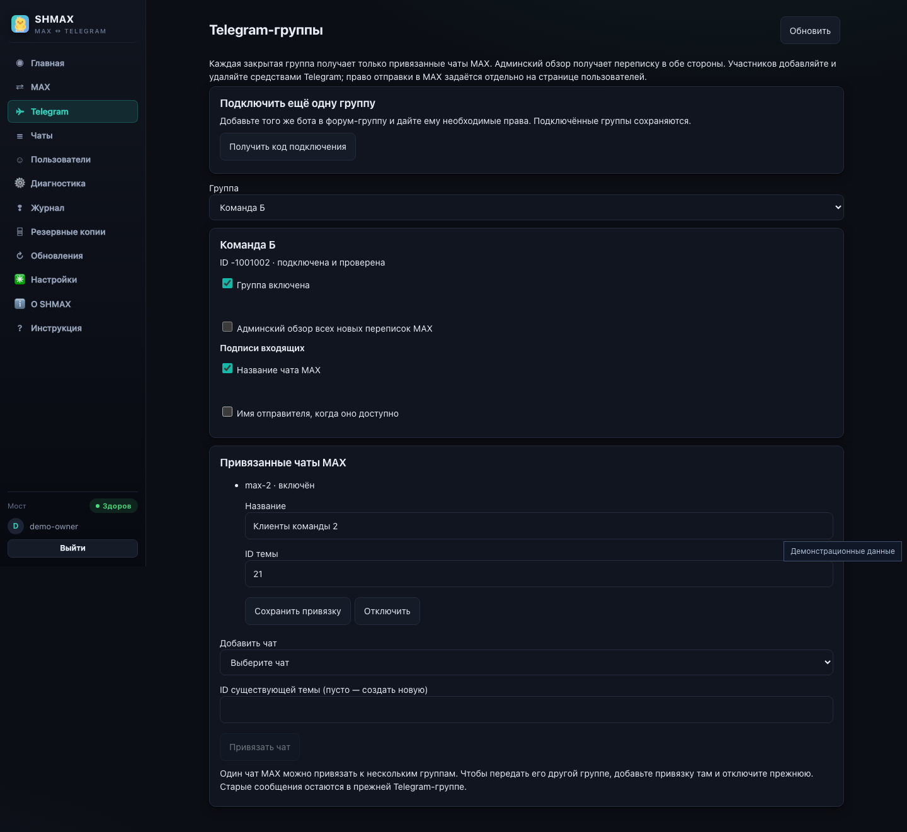 | 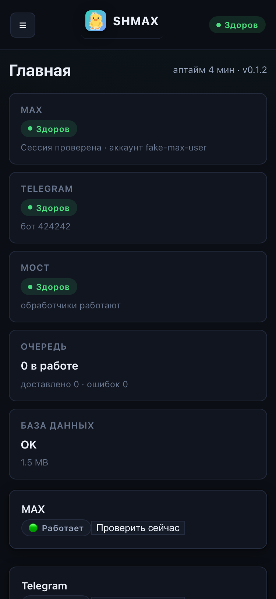 |

## Безопасность

SHMAX использует шифрование хранилища секретов, разграничение доступа и защиту
веб-сеансов. Веб-контейнер не получает доступ к Docker socket. Установите защиту
доступа к панели управления и храните резервные копии в защищённом месте.

Об уязвимостях сообщайте через приватный канал GitHub, указанный в
[политике безопасности](SECURITY.md). Не размещайте данные авторизации в issues.

## Документация и участие в проекте

[Документация на русском](docs/ru/README.md) ·
[Documentation in English](docs/en/README.md) ·
[Руководство для ИИ-ассистентов](docs/AI_ASSISTANT_GUIDE.ru.md) ·
[Участие в разработке](CONTRIBUTING.md)

SHMAX — независимый проект с открытым исходным кодом. Разработка не связана с
компаниями, управляющими MAX или Telegram.

## Лицензия

Проект распространяется под [AGPL-3.0-or-later](LICENSE).
[Сторонние компоненты и лицензии](THIRD_PARTY_NOTICES.md) ·
[Использование названия и символики](TRADEMARKS.md).
