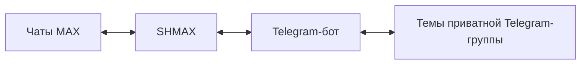

# SHMAX

**Шлюз между MAX и Telegram для собственного сервера**

SHMAX объединяет переписку в MAX и Telegram. Сообщения из выбранных чатов MAX
поступают в темы приватной Telegram-группы; ответы из Telegram отправляются
обратно в соответствующие чаты MAX. Шлюз работает на вашем сервере и предоставляет
веб-интерфейс для настройки подключений, маршрутов и доступа пользователей.

[English](README.en.md) · [Документация](docs/ru/README.md) ·
[Выпуски](https://github.com/SHMAX-Project/SHMAX/releases) · [Безопасность](SECURITY.md)


## Возможности

- **Обмен сообщениями в обе стороны.** Текст, фото, документы и поддерживаемое
  видео; сопоставление ответов и подписи отправителей.
- **Маршрутизация по темам.** Каждый подключённый чат MAX связан с отдельной
  темой Telegram-форума.
- **Управление доступом.** Одобрение участников, роли, блокировки и подписи
  операторов. Права в SHMAX настраиваются отдельно от прав администратора Telegram.
- **Настройка сети.** Прямое подключение, SOCKS5, HTTP-прокси и управляемый Xray
  для доступа к Telegram.
- **Контроль подключений.** Состояние интеграций, диагностика, журнал и
  автоматическое восстановление сохранённого Telegram-транспорта.
- **Резервное копирование.** Локальные копии и зашифрованный экспорт для переноса
  конфигурации и данных на другой сервер.
- **Обновление с откатом.** Проверка контрольных сумм, резервная копия перед
  установкой, проверка работоспособности и автоматический откат при ошибке.
- **Веб-интерфейс.** Мастер первоначальной настройки, отдельные настройки MAX
  и Telegram, защита несохранённых изменений и адаптация для мобильных устройств.

Подробности обработки вложений и стикеров приведены в [документации по медиа](docs/ru/media.md).

## Как работает шлюз



Для работы нужны обычный аккаунт MAX, собственный Telegram-бот и приватная
супергруппа Telegram с включёнными темами. Подключения и соответствия чатов
настраиваются в веб-интерфейсе. Один экземпляр SHMAX работает с одной
связанной Telegram-группой.

Необязательная [синхронизация участников](docs/ru/telegram-group.md) использует
существующего бота и Telegram API ID/API Hash. Обнаружение участника не выдаёт
ему право отправлять сообщения: доступ предоставляется после одобрения.

## Требования

- Debian 13, архитектура amd64.
- Docker Engine, Docker Compose v2 и systemd.
- Права администратора сервера для установки.
- Доступ сервера к MAX, Telegram и источникам зависимостей при установке.

Приложение работает в контейнере. Конфигурация, база данных и авторизация хранятся
отдельно в `/var/lib/shmax` и сохраняются при замене контейнера и обновлении.
Описание компонентов: [архитектура](docs/ru/architecture.md).

## Установка

Скачайте полный production-архив из [GitHub Releases](https://github.com/SHMAX-Project/SHMAX/releases)
вместе с `SHA256SUMS`. Проверьте контрольную сумму и распакуйте архив.
Из каталога распакованного релиза выполните:

```bash
sudo bash deploy/installer/install.sh --mode install
```

Установщик подготовит службы, соберёт и запустит контейнер, затем предоставит
ссылку первоначальной настройки. В мастере создайте администратора, подключите
MAX и Telegram, выберите чаты и настройте права участников.

[Инструкция по установке](docs/ru/installation.md) ·
[Первоначальная настройка](docs/ru/first-setup.md) ·
[Решение проблем](docs/ru/troubleshooting.md)

## Обновления и данные

Обновления устанавливаются по решению администратора. Перед установкой SHMAX
создаёт резервную копию, проверяет архив и после обновления контролирует
работоспособность приложения. При ошибке выполняется откат.

Для переноса на другой сервер используйте зашифрованный экспорт `.shmax` с
паролем. Обычная локальная копия содержит материал авторизации и требует
защищённого хранения. Перед запуском перенесённого экземпляра остановите исходный
шлюз. [Резервные копии](docs/ru/backups.md) · [Восстановление](docs/ru/restore.md).

## Интерфейс

Скриншоты показывают интерфейс с демонстрационными данными.

| Настройки Telegram | Пользователи |
|---|---|
|  |  |

| Маршрутизация чатов | Мобильный интерфейс |
|---|---|
|  |  |

## Безопасность

SHMAX использует шифрование хранилища секретов, разграничение доступа и защиту
веб-сеансов. Веб-контейнер не получает доступ к Docker socket. Установите защиту
доступа к панели управления и храните резервные копии в защищённом месте.

Об уязвимостях сообщайте через приватный канал GitHub, указанный в
[политике безопасности](SECURITY.md). Не размещайте данные авторизации в issues.

## Документация и участие в проекте

[Документация на русском](docs/ru/README.md) ·
[Documentation in English](docs/en/README.md) ·
[Руководство для AI-ассистентов](docs/AI_ASSISTANT_GUIDE.ru.md) ·
[Участие в разработке](CONTRIBUTING.md)

SHMAX — независимый проект с открытым исходным кодом. Разработка не связана с
компаниями, управляющими MAX или Telegram.

## Лицензия

Проект распространяется под [AGPL-3.0-or-later](LICENSE).
[Сторонние компоненты и лицензии](THIRD_PARTY_NOTICES.md) ·
[Использование названия и символики](TRADEMARKS.md).
