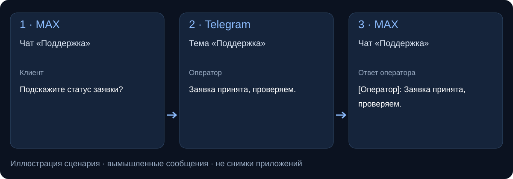
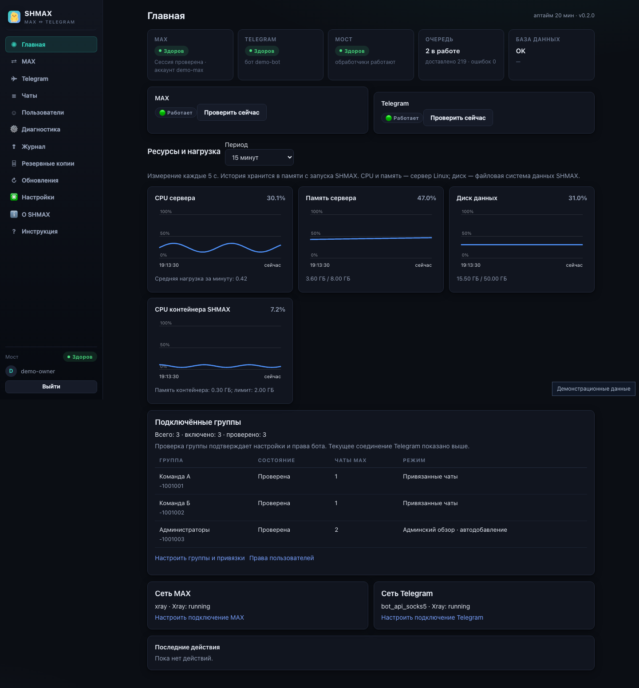
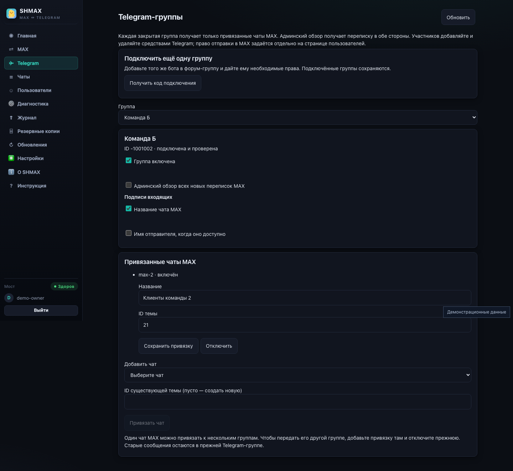
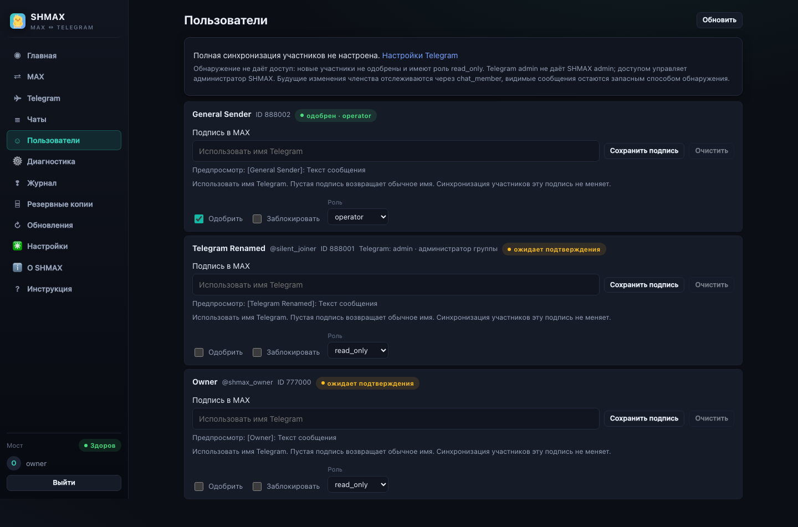
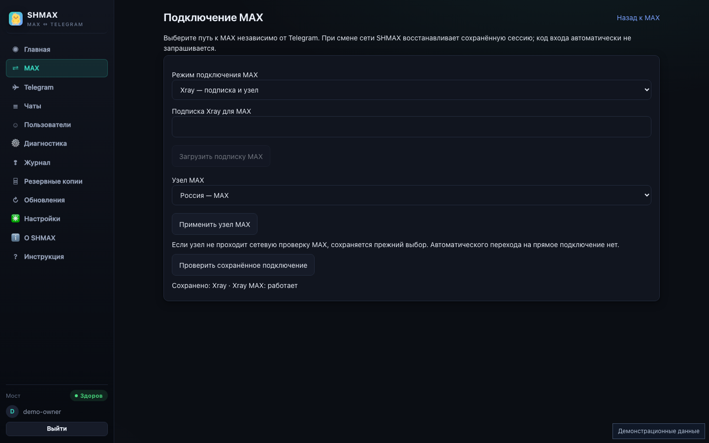
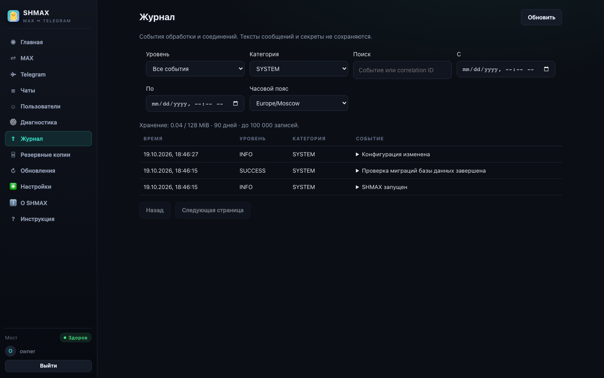
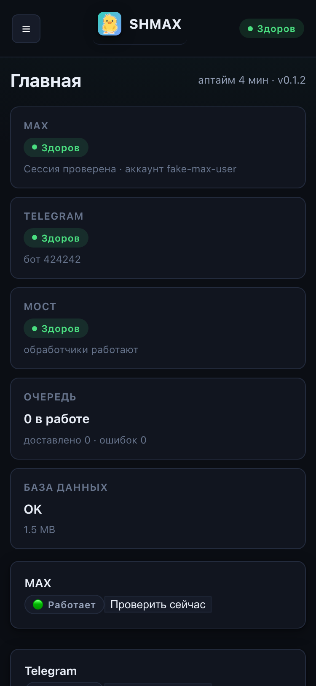
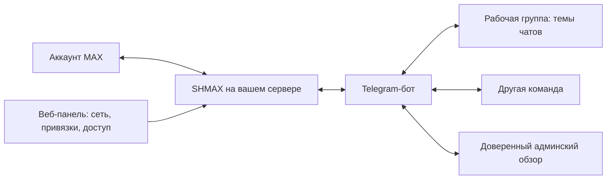

<p align="center"></p>

<h1 align="center">SHMAX</h1>
<p align="center"><strong>MAX — на сервере. Telegram — на телефоне.</strong></p>
<p align="center">Не хотите устанавливать MAX на личный телефон?<br>SHMAX подключает ваш аккаунт на сервере или VPS.<br>Получайте сообщения и отвечайте из тем Telegram.</p>
<p align="center"><a href="#быстрый-старт">Установить</a> · <a href="docs/ru/use-cases.md">Выбрать сценарий</a> · <a href="#интерфейс">Посмотреть интерфейс</a> · <a href="README.en.md">English</a></p>

<p align="center">
<a href="https://github.com/SHMAX-Project/SHMAX/releases/latest"></a>
<a href="https://github.com/SHMAX-Project/SHMAX/actions/workflows/ci.yml"></a>
<a href="docs/ru/installation.md"></a>
<a href="LICENSE"></a>
</p>



*Схема на вымышленных сообщениях. Ниже — настоящий интерфейс с демонстрационными данными.*

## MAX без приложения на телефонах участников

**Для личного использования:** выбранные чаты MAX приходят в вашу закрытую Telegram-группу. Читайте сообщения и отвечайте из Telegram — для ежедневной переписки приложение MAX на основном телефоне не требуется.

**Для компании:** подключите рабочий аккаунт MAX на сервере или VPS и распределите чаты между командами. Сотрудникам не нужно устанавливать MAX на личные телефоны и передавать друг другу сеанс аккаунта: они работают через Telegram и выданные права SHMAX.

**Первый вход — отдельный шаг.** Владелец должен иметь аккаунт MAX, доступ к номеру и пройти проверки сервиса. Иногда MAX требует настроить 2FA в официальном приложении на авторизованном устройстве. SHMAX не обходит эти требования. [Как устроен сценарий и что остаётся у MAX/Telegram →](docs/ru/max-without-phone.md)

## Когда пригодится SHMAX

**Вам пишут в MAX, а вы привыкли к Telegram.** Подключите нужные чаты, дайте каждому свою тему и отвечайте из привычного приложения. Собеседник продолжит пользоваться MAX.

**У вас несколько команд.** Направьте чаты в отдельные закрытые Telegram-группы: поддержке — свои обращения, другой команде — свои. Право отправки в MAX назначается отдельно для каждой группы.

**Нужен общий обзор.** Выделите доверенную админскую группу: SHMAX может автоматически создавать темы для новых чатов MAX и показывать входящие сообщения и подтверждённые ответы.

**Всё это работает на вашем сервере.** Вы управляете подключениями, доступом, данными SHMAX и резервными копиями. Веб-панель нужна для настройки; ежедневная переписка остаётся в Telegram.

[Разобрать сценарии по шагам →](docs/ru/use-cases.md)

## Интерфейс

Главная показывает подключения MAX и Telegram, группы, очередь и ресурсы сервера.



<details>
<summary><strong>Посмотреть маршруты чатов, права пользователей и мобильную версию</strong></summary>

### Какой чат куда попадает



### Кто может отвечать



### Сеть и журнал событий

| Независимое подключение MAX | Поиск причин недоставки |
|---|---|
|  |  |

<p align="center"></p>

Снимки сделаны с демонстрационными подключениями, а не с перепиской пользователей. [Происхождение скриншотов](docs/assets/screenshots/README.md).

</details>

## Быстрый старт

Понадобятся **сервер с Debian 13 amd64**, доступ root/sudo, один обычный аккаунт MAX и собственный Telegram-бот. В Telegram создайте закрытую группу с включёнными **темами**; боту нужны права отправки и управления темами, а Privacy Mode должен быть отключён.

```bash
curl -fsSL https://raw.githubusercontent.com/SHMAX-Project/SHMAX/main/install.sh | sudo bash
```

Установщик скачает последний стабильный выпуск, проверит подпись и целостность пакета, подготовит Docker/Compose и выведет ссылку настройки.

1. **Откройте ссылку и создайте владельца SHMAX.** Это локальная учётная запись панели.
2. **Подключите MAX и Telegram в мастере.** Сеть каждого сервиса настраивается независимо; мастер проведёт через авторизацию MAX, бота и подключение группы.
3. **Выберите чаты MAX и одобрите отправителей.** Каждый чат получит свою тему. Отправьте сообщение из MAX, затем ответьте из Telegram — проверьте оба направления.

[Подробная установка](docs/ru/installation.md) · [Мастер по шагам](docs/ru/first-setup.md) · [Ручная установка с проверкой подписи](docs/ru/installation.md#ручная-установка-из-архива) · [Если что-то не работает](docs/ru/troubleshooting.md)

## Что умеет текущая версия

| Вам нужно | Что делает SHMAX |
|---|---|
| Отвечать на MAX из Telegram | Передаёт сообщения в обе стороны, сопоставляет ответы и добавляет подписи авторов |
| Не смешивать разговоры | Связывает чаты MAX с отдельными темами; один чат можно направить в несколько групп |
| Работать командой | Даёт права отправки по группам, роли и глобальную блокировку пользователя |
| Передавать вложения | Поддерживает фотоальбомы MAX → Telegram по 2–10 фото, документы и поддерживаемое видео; [ограничения](docs/ru/media.md) |
| Настроить разные подключения | Direct, HTTP, SOCKS5 и управляемый Xray отдельно для MAX и Telegram |
| Разобраться со сбоем | Показывает состояния подключений, очередь, журнал событий и графики ресурсов |
| Обновиться или переехать | Подписанные обновления, резервные копии и зашифрованный перенос; [порядок обновления и отката](docs/ru/updates.md) |

**Стабильный выпуск: [v0.2.0](https://github.com/SHMAX-Project/SHMAX/releases/latest).** Несколько рабочих групп, админский обзор, отдельная сеть MAX и графики ресурсов уже доступны. [Изменения](release/v0.2.0/RELEASE_NOTES.ru.md) · [История версий](CHANGELOG.md).

## Важно перед запуском

- **Один аккаунт MAX на экземпляр.** Несколько Telegram-групп поддерживаются; несколько аккаунтов MAX пока нет.
- **Приватность определяется всей цепочкой.** Данные SHMAX хранятся на вашем сервере, но сообщения также проходят через MAX и Telegram. Все участники Telegram-группы видят её историю по правилам Telegram. Для разделения просмотра создавайте отдельные закрытые группы; права SHMAX управляют отправкой в MAX.
- **Админский обзор — только для доверенных участников.** В него могут попадать и личные чаты подключённого аккаунта. Старая история MAX автоматически не выгружается.
- **Серверу нужен доступ к обоим сервисам.** При сетевой ошибке смотрите состояние и журнал; неопределённый ответ внешнего API не позволяет гарантировать доставку ровно один раз.
- **Проверенная платформа — Debian 13 amd64.** ARM64 и ARMv7 — экспериментальные Docker-цели без завершённой физической приёмки. История графиков хранится в памяти до часа.

[Ответы на частые вопросы](docs/ru/faq.md) · [Безопасность](SECURITY.md) · [Дорожная карта](docs/ru/roadmap.md)

## Обновления и сохранность данных

Настройки, база и сеансы находятся в `/var/lib/shmax`, отдельно от контейнера. Для обновления используйте `sudo shmax update`: SHMAX проверяет пакет, создаёт холодную копию, проверяет запуск кандидата и выполняет откат при ошибке. Перед обновлением сохраните проверенную резервную копию; возврат старой схемы требует копии до обновления.

Для переноса есть зашифрованный `.shmax`-экспорт. Перед запуском нового экземпляра остановите старый: один аккаунт и бот не должны одновременно обслуживаться двумя шлюзами.

[Резервные копии](docs/ru/backups.md) · [Перенос и восстановление](docs/ru/restore.md) · [Первый опыт эксплуатации](docs/ru/deployment-story.md)

<details>
<summary><strong>Архитектура и проверки выпуска</strong></summary>



В v0.2.0 проверены подписанное обновление Debian 13 amd64, миграция данных, перезапуск компонентов и полный ребут VM. Отдельные прогоны охватывают frontend, альбомы, доставку по группам и старые форматы резервных копий. Живые тестовые сообщения при этой приёмке не отправлялись; все сочетания внешних сервисов и медиа не объявляются проверенными.

[Протокол приёмки и ограничения](release/v0.2.0/VALIDATION.md) · [Архитектура](docs/ru/architecture.md) · [Группы и права](docs/ru/multi-group.md)

</details>

## Документация и помощь

[Документация RU](docs/ru/README.md) · [English documentation](docs/en/README.md) · [Сообщить об ошибке](https://github.com/SHMAX-Project/SHMAX/issues/new/choose) · [Помочь проекту](CONTRIBUTING.md) · [Инструкции для агентов](docs/AI_ASSISTANT_GUIDE.ru.md)

Если SHMAX оказался полезен, поставьте звезду или поделитесь своим сценарием в [задачах проекта](https://github.com/SHMAX-Project/SHMAX/issues). Не публикуйте токены, сеансы и переписку пользователей.

SHMAX — независимый проект, не связанный с компаниями, управляющими MAX или Telegram. [AGPL-3.0-or-later](LICENSE) · [Сторонние лицензии](THIRD_PARTY_NOTICES.md) · [Название и символика](TRADEMARKS.md).
