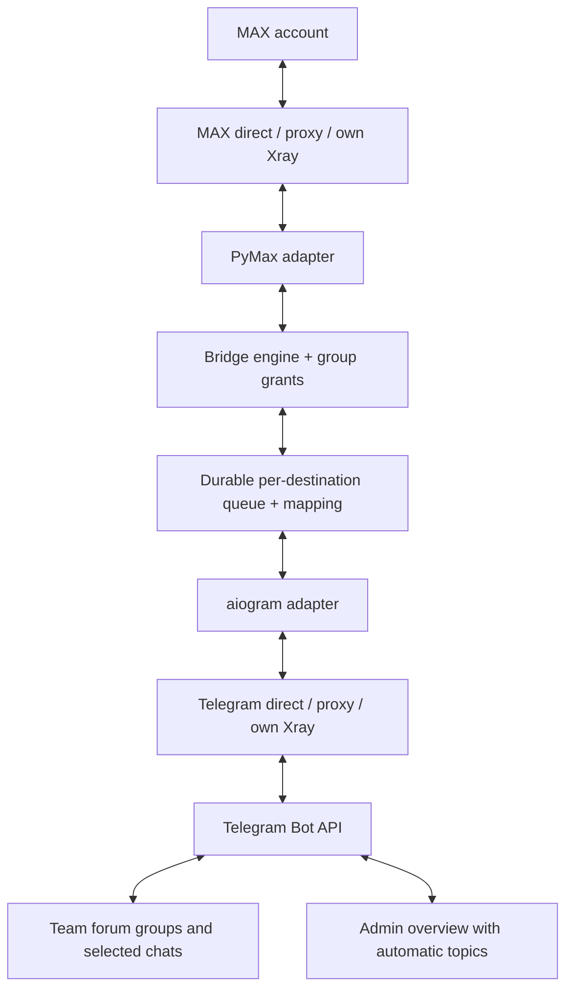

# Architecture

Host: Debian 13 runs Docker (SHMAX container), `shmax-hostd`
(restricted host helper on a unix socket, fixed op set, no shell),
`shmax-boot.service` (wait for bind address, repair port
publication, host readiness), `/opt/shmax` deployment and
`/var/lib/shmax` persistent data.

Component table (role / trust boundary / state / failure symptoms)
and per-subsystem details: see [../ru/architecture.md](../ru/architecture.md)
(canonical) — the RU table covers web frontend, FastAPI, SQLite +
SQLAlchemy + Alembic, SecretStore, MAX/Telegram adapters, network
abstraction, Xray, routing, queues, idempotency, reply mapping,
echo suppression, attachments/fallback, ACL, watchdogs, installer,
Docker/compose, hostd, update service, backup manager and boot
orchestration.

## Member synchronization

Optional MTProto **bot** sync discovers silent members; `chat_member` updates membership. New users stay unapproved (`read_only`); Telegram admin grants no SHMAX admin. API Hash is encrypted in SecretStore; the session exists only in memory. The bridge works without sync configuration. See [Telegram group](telegram-group.md#automatic-participant-discovery) for network, backup and Privacy Mode limitations.

MAX has an independent direct, HTTP, SOCKS5 or Xray connection; see [MAX networking](max-network.md). Bot API polling has no session file. Auxiliary Telethon
sync verifies bot identity, receives no updates and never replaces the aiogram
poller. Its session is memory-only; API Hash is in SecretStore and users in the DB.
Runs serialize and disconnect on completion/cancellation. Pages have up to 200
members, the cap is 20,000 and timeout 180 seconds; one FloodWait up to 30 seconds
allows one retry. Partial/capped imports are not reported as success. Pairing
schedules a background run; restored startup schedules one after 10 seconds.
There is no frequent enumeration loop.

### Telegram → MAX local author override

Before enqueueing delivery, the bridge reads persisted `telegram_users.nickname` from the user repository. Canonical attribution prefers this override, then Telegram display name, then @username and a safe fallback. Text, replies and captions use one `[Анна]: text` prefix; retries preserve the selected signature. MAX → Telegram retains its existing MAX author resolution.

## Portable state

Portable UI → CSRF/owner API → authenticated disk staging → hostd job ID
→ stop/migrate/swap/start/readiness → rollback on failure. The Docker data-mount
inode is preserved: only persistent subdirectories are swapped. Destination
.env/compose deployment settings remain local. See [restore](restore.md) and
[media](media.md).

## v0.2.0

Routes, source/sender labels and send grants are configured per Telegram group. A MAX chat can have multiple destinations; administrator overview groups create topics automatically. Durable jobs and message mappings are destination-specific; albums retain their members and topic in each group. MAX networking is independent of Telegram. See [groups and access](multi-group.md), [MAX networking](max-network.md) and [media](media.md).
