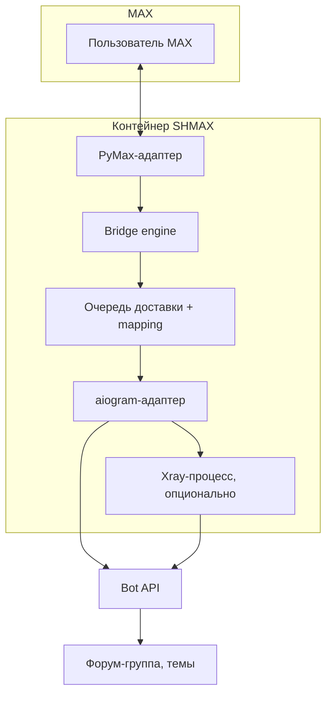
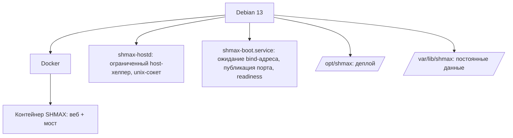

# Архитектура: что, зачем, как общается, где состояние

Приложение одноразово, данные постоянны.

## Диаграмма потоков сообщений

## Диаграмма хоста

## Компоненты (роль / доверенная граница / состояние / что ломается)

| Компонент | Роль | Граница доверия | Состояние | Симптомы отказа |
|---|---|---|---|---|
| Веб-фронтенд (React/Vite) | UI | браузер пользователя | нет (SPA) | не грузится → проверьте статик (A12) |
| FastAPI backend | API, сессии, CSRF | держит сессии админа | SQLite + SecretStore | 401/403, 5xx |
| SQLite + SQLAlchemy + Alembic | хранение | только контейнер | `db/shmax.db` | ошибки миграций |
| SecretStore | AES-256-GCM секреты | мастер-ключ в `secrets/` | `secrets/` | «secret not found» |
| MAX-адаптер (PyMax) | вход в MAX | аккаунт MAX | `sessions/max/` | DEGRADED MAX, 2FA-запросы |
| Telegram-адаптер (aiogram) | бот | Bot API | настройки и runtime; файловой сессии нет | 401/409, poller |
| Member-sync (Telethon) | импорт участников существующим ботом | MTProto, проверка bot ID | сессия только в памяти; API Hash в SecretStore, участники в БД | неполный импорт; мост продолжает работу |
| Telegram-сеть | транспорт выбор | прокси/Xray | state | Telegram DOWN |
| Xray-процесс | локальный SOCKS | 127.0.0.1:порт | ephemeral config 0600 | Telegram через Xray недоступен |
| Очередь + mapping + echo-registry | доставка ровно-один-раз-на-практике | внутренняя | таблицы БД | дубли, потеря ответов |
| ACL | fail-closed | внутренняя | `telegram_users` | «не могу писать в MAX» |
| Watchdog/супервизоры | здоровье, один poller | внутренняя | `state/watchdogs.json` | DEGRADED без реконнекта |
| Инсталлятор | деплой | root на хосте | `/opt/shmax` | — |
| shmax-hostd | ограниченные host-операции | unix-сокет 0660, БЕЗ произвольных команд | нет | «host helper unavailable» |
| Update-сервис | GitHub Releases | только доверенные origin'ы | `settings` в БД | «не удалось проверить» |
| Backup manager | копии | читает `/var/lib/shmax` | `backups/*.shmax` 0600 | пустая копия |
| Boot-оркестрация | возврат после ребута | root, docker CLI | нет | недоступен после ребота |

Подробности подсистем: [../architecture.md](../architecture.md)
(исторический документ), [updates.md](updates.md),
[backups.md](backups.md).

## Синхронизация участников

Синхронизация Telegram обнаруживает молчавших участников через MTProto **бота**, а `chat_member` обновляет членство. Новые участники остаются не одобрены (`read_only`); Telegram admin не даёт SHMAX admin. API Hash хранится в SecretStore, сессия — только в памяти. Без необязательных настроек мост работает. Подробности, ограничения сети, backup и Privacy Mode: [Telegram-группа](telegram-group.md#автоматическое-обнаружение-участников).

MAX всегда direct. Вспомогательный клиент не принимает обновления и не заменяет
aiogram poller. Он проверяет идентичность бота, отключается при завершении/отмене;
запуски сериализованы. Страницы до 200 участников, максимум 20 000, таймаут 180 с;
один FloodWait до 30 с допускает одну повторную попытку. Превышение предела или
частичный результат не выдаются за успех. После pairing — фоновый запуск, при
восстановленном старте — запуск с задержкой 10 с; частого опроса нет.

### Локальное имя автора Telegram → MAX

Мост читает сохранённый `telegram_users.nickname` из репозитория пользователей перед постановкой доставки в очередь. Каноническая атрибуция выбирает локальную подпись, затем Telegram display name, затем @username и безопасное запасное имя. Текст, ответ и caption используют один префикс `[Анна]: текст`; повтор доставки сохраняет выбранную подпись. MAX → Telegram использует прежнее разрешение MAX-автора.

## Перенос состояния

Portable UI → CSRF/owner API → disk-backed authenticated staging → hostd job ID
→ stop/migrate/swap/start/readiness → rollback при сбое. Каталог /var/lib/shmax
не заменяется целиком: сохраняется inode Docker mount, меняются только постоянные
подкаталоги. Deployment .env/compose нового хоста не импортируются.
См. [восстановление](restore.md) и [медиа](media.md).
